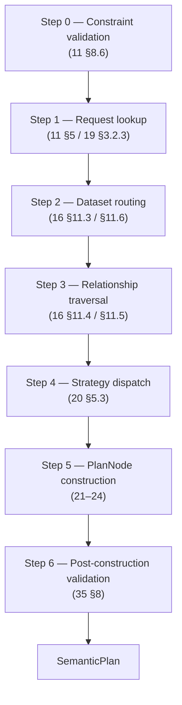

# Plan Function and Pipeline

This leaf owns the plan() free function signature, 7-step pipeline (step 0 constraint validation, step 1 Request lookup, step 2 Dataset routing, step 3 composition consistency check, step 4 Strategy dispatch, step 5 PlanNode construction, step 6 post-construction validation), field-first resolution, diagnostics accumulation (fail-fast policy).

## 6. The `plan` function signature

### 6.1 Signature

```rust
use semstrait_common::diagnostic::{Diagnostic, Diagnostics};

/// Planner entry point. Per `10 §3.4`.
///
/// Consumes a read-only `SemanticManifest` reference and an owned `Request`;
/// returns a well-formed `SemanticPlan` plus warnings on success, or a
/// fail-fast `(Diagnostic<PlanErrorKind>, Diagnostics<PlanErrorKind>)`
/// pair on failure (per `30 §7.2`).
///
/// Sync (I6). Never mutates the SemanticManifest (I8 / I5). Performs no I/O
/// (I11). Accumulates warnings across both arms per `30 §7.3` — they
/// flow on the success-tuple's second element or the failure-tuple's
/// second element respectively. The success-arm `SemanticPlan.diagnostics`
/// (`35 §3.1`) is a content-equivalent copy retained on the artifact.
pub fn plan(
    manifest: &SemanticManifest,
    request: Request,
) -> Result<
    (SemanticPlan, Diagnostics<PlanErrorKind>),
    (Diagnostic<PlanErrorKind>, Diagnostics<PlanErrorKind>),
>;
```

**Input ownership.** `SemanticManifest` is borrowed (never consumed) — a SemanticManifest is typically cached across many `plan` calls; the planner takes a read-only view. `Request` is owned (consumed) — its fields are destructured into the internal `ResolvedQueryRequest` representation, and retaining the caller's copy has no utility.

**Return shape.** Matches `30 §7.2`'s fail-fast pattern verbatim: success arm `(SemanticPlan, Diagnostics<PlanErrorKind>)`, failure arm `(Diagnostic<PlanErrorKind>, Diagnostics<PlanErrorKind>)`. The fatal `Diagnostic<PlanErrorKind>` carries primary `Location` on its envelope per `30 §5.1`; the wrapped `PlanErrorKind` carries semantic payload only. No bespoke carrier struct.

### 6.2 Preconditions on `manifest`

The SemanticManifest must satisfy every invariant in `33 §4` / `§10` / `§12` — in particular, `bindings`, `data_kinds`, `relationships`, and typed expression pools must be internally consistent so graph build can derive indices before planning. Feeding a partially-built SemanticManifest is a caller error; planner graph/index checks raise `PlanErrorKind::SemanticManifestIndexInconsistent` where possible but are not exhaustive. Multi-thread access is safe per `33 §12` — a single `SemanticManifest` may back concurrent `plan` calls.

### 6.3 Postconditions

**On success** (`Ok((plan, warnings))`): every `SemanticPlan` invariant from `35 §3.2` holds — `output_names.len()` equals `root.meta().output_schema.len()`, every `Name` is valid per `35 §6.4`, the tree satisfies `35 §8` well-formedness, and `warnings` (and the artifact-side `plan.diagnostics`) carry no `Severity::Error` entries. Step 6 (§7.7) is the enforcement point.

**On failure** (`Err((fatal, warnings))`): `fatal.severity == Severity::Error`; `fatal.kind` is a `PlanErrorKind` variant identifying the failure category; `warnings` carries every `Severity::Warning` `Diagnostic<PlanErrorKind>` emitted before the fail-fast abort.

### 6.4 Thread-safety

`plan` is `Send` on the invoking thread and reentrant under concurrent invocations against the same SemanticManifest (reads only; no interior mutability across calls).

## 7. Legacy direct-plan pipeline notes (transitional)

This section preserves pre-split direct-plan wording for migration context. The authoritative planner pipeline is `§1.4A` plus `10 §3.4`. Any conflict between this section and `§1.4A` is resolved in favor of `§1.4A`.

### 7.1 Step 0 — Constraint validation (`11 §8.6`)

**Work.** Invoke `ConstraintValidator::check(request, manifest)` per `11 §8.6`. The v1 checker iterates every Measure and Metric named in `request.measures` / `request.metrics`, resolves each via the SemanticManifest's name index, and evaluates every `MeasureConstraints` entry against the Request's query scope (`dimensions` ∪ filter-field Dimensions) and against the Measure's effective aggregation.

**Output.** Either a successful advance to step 1, or a fail-fast abort with `PLAN_E_0500 ConstraintViolation { entity, message }` per `11 §8.7`. The v1 checker short-circuits on first violation; future fan-out (`[TD-CONSTRAINT-ERROR-FANOUT]`) refines the carrier without changing step-0 placement.

**Why step 0.** Constraint violations express author-declared admissibility rules. Running them before any SemanticManifest-index work avoids redundant field-first resolution / relationship / dispatch work on Requests that cannot be planned by author intent.

### 7.2 Step 1 — Request lookup (`11 §5`)

**Work.** Per `11 §5`'s lookup algorithm and `19 §3.2.3`'s O(1) guarantee:

1. For each name in `request.dimensions` ∪ `request.measures` ∪ `request.metrics`, look up the `SemanticsName` in the SemanticManifest's name index. Unknown names raise `PLAN_E_0508 UnknownSemantics { name }` per `16 §14.3`.
2. Record each name's `SemanticElement` and owning `DataKindRef`. Mismatch with the field the name was placed in raises `PLAN_E_0512 RequestFieldTypeMismatch`.
3. For each `Filter.field`, look up similarly; arity mismatch raises `PLAN_E_0520`; value-type mismatch raises `PLAN_E_0521`.
4. Duplicate names within any field list raise `PLAN_E_0510`.

No name resolution beyond the pre-built index (I5). Complexity is O(names × log n) over `BTreeMap`-backed indices per `19 §3.2.1`.

**Output.** Partially-built `ResolvedQueryRequest` — resolved refs populated; `target` not yet set. Step-1 errors sit in the `PLAN_E_05xx` band per `30 §6.2`.

### 7.3 Step 2 — Dataset routing

Two-branch decision:

- **Explicit (`request.from == Some(d)`).** Per `16 §11.6`: look up `d` in the graph/manifest DataKind index (`graph.datakind_index`). Absent → `PLAN_E_2040`. For every resolved Semantics, assert the owner equals `d` (Simple) or appears in `d`'s constituents (Complex); violation → `PLAN_E_0507 SemanticsNotOnSurface`. Set `target = Explicit(d)`.
- **Implicit (`request.from == None`).** Invoke field-first resolution (§10 / `16 §11`). Output is `ResolvedTarget::Implicit(d)` (single-kind fast path) or `ResolvedTarget::Composition(d)` (constituent-set lookup hit per §10.2 step 4). Errors: `PLAN_E_0500` / `PLAN_E_0501` / `PLAN_E_0502` / `PLAN_E_0503` / `PLAN_E_0508`.

### 7.4 Step 3 — Composition consistency check

For composition targets (`ResolvedTarget::Explicit(d)` where `d` is Complex, or `ResolvedTarget::Composition(d)`), the planner consumes the graph-built composition entry from `graph.composition_index(d)`:

- **Composition target (explicit or implicit):** `traversed_paths` is materialized during graph build per `16 §10`. Step 3 walks the path edges to confirm every relationship `EntityId` resolves in the manifest relationship scope (`manifest.relationships`, holding `ResolvedRelationship` per `33 §8A`, plus Joinset-local shadows) and packages the per-edge resolved join keys (`ResolvedJoinKey` semantic-id pairs + the resolved `join_type` / `filter`) that strategies consume.
- **Simple target:** step 3 is a no-op.

`PLAN_E_2052 SemanticManifestIndexInconsistent` surfaces here when a recorded relationship `EntityId` is missing from the expected relationship scope — a manifest/graph integrity bug, not a plan-time failure mode under valid inputs.

### 7.5 Step 4 — Strategy dispatch (`20 §5.3`)

Invoke `dispatch_strategy(kind, &registry)` per `20 §5.3`: a single `match` on the `ResolvedDataKind` variant returning `&dyn Strategy`. Per `20 §5.3`, this is the **only** variant-match site in the hot path; every other planner site consumes `&dyn Strategy`. Defensive errors: `PLAN_E_2050`, `PLAN_E_2051`.

### 7.6 Step 5 — `PlanNode` construction

The dispatched strategy's `plan` method (§8) builds the subtree rooted at the target DataKind. Algorithm pointers by variant:

- `SimpleStrategy` (§9.1, `21 §4`) — 5-layer shape (Scan / Rename / Expression / Aggregate / Project) with interleaved `Filter`.
- `GrainsetStrategy` (§9.2, `22 §4`–§5) — child selection, recursive dispatch, optional rollup wrap.
- `UnionsetStrategy` (§9.3, `23 §4`) — per-branch recursive dispatch, NULL-fill seam, `Union`, optional re-aggregation.
- `JoinsetStrategy` (§9.4, `24 §5`) — anchor-outward path walk, per-member recursive dispatch, `Join` sequences, reconciling `Project`.

After the strategy returns, the planner wraps with Request-level nodes: (1) user-filter `Filter` nodes at the appropriate layer, (2) `Sort` if `order` non-empty, (3) `Fetch` if `limit` / `offset` set, (4) outermost `Project` pinning output column order.

Errors: per-variant `PLAN_E_21xx` / `PLAN_E_22xx` / `PLAN_E_23xx` / `PLAN_E_24xx` surfaced through the `PlanError::{Simple|Grainset|Unionset|Joinset}` wrapper variants; shared `PLAN_E_0600 PlanNodeConstructionFailed`, `PLAN_E_0601 UnsupportedRequestShape`.

### 7.7 Step 6 — Post-construction validation (`35 §8`)

Invoke `SemanticPlan::validate()` per `35 §9.3`. The validator walks the tree and checks every `35 §8` invariant (schema alignment, type resolution, predicate well-typedness, join-key agreement, union arm parity). Failure wraps an `IR_E_35xx` error into `PLAN_E_0610 PostConstructionInvariantViolated`.

**Production posture.** In optimized builds, step 6 is a no-op by default — strategies are trusted to produce well-formed plans. Test builds (`cfg(test)` + `debug_assertions`) always run it. An operator concerned about planner regressions opts in via the `semstrait.plan.validate` feature toggle (`planner-request.md §4.2`).

### 7.8 Pipeline summary diagram




Every arrow is fail-fast — a failure short-circuits to `Err(PlanErrors)` with accumulated warnings (§14).

## 10. Field-first resolution

### 10.1 When it runs

Step 2 of the pipeline (§7.3) invokes field-first resolution when `request.from == None`. When `request.from` is `Some(d)`, step 2 takes the explicit-routing branch per `16 §11.6` and field-first resolution is skipped entirely.

### 10.2 Algorithm — lookup-only over `SemanticGraph` build-time indices (`16 §11`)

The algorithm's canonical ratification is `16 §11`; §10 here records the planner-side realization. Per `33 §4.1` / `§6.8` and `16 §10`, the manifest persists primitives only, while explicit and implicit compositions are synthesized into `SemanticGraph` at graph-build time. Plan-time resolution is therefore lookup-only over graph-held indices — no plan-time BFS / Steiner walk and no on-demand synthesis.

1. **Name-to-kind map (`16 §11.2`).** For each `SemanticsName` in `request.dimensions ∪ request.measures ∪ request.metrics ∪ request.filters.field`, consult `graph.name_index(name)`:
  - `None` → `PLAN_E_0508 UnknownSemantics { name }`.
  - `Some(owning)` → record the `Vec<DataKindRef>`.
2. **Candidate kind set `T`.** Deduplicate `⋃ owning` across selected names.
3. **Single-kind fast path (`16 §11.3`).** If `|T| == 1`, return `ResolvedTarget::Implicit(T[0])`.
4. **Multi-target lookup (`16 §11.4`).** If `|T| >= 2`, query `graph.composition_by_constituent_set(&T)`:
  - **Single match** → `ResolvedTarget::Composition(name)`.
  - **Multi match** → `PLAN_E_0500 AmbiguousImplicitComposition`.
  - **No match** → `PLAN_E_0501 NoCompositionPath` or `PLAN_E_0502 CompositionDepthExceeded` (when the graph build recorded a cap hit).
5. **Return.** `ResolvedTarget::{Implicit | Composition(name)}`; strategy dispatch remains variant-driven and origin-agnostic.

### 10.3 Integration with graph-build indices

The planner reads graph-build indices reconstructed from manifest primitives:

- `graph.name_index: BTreeMap<SemanticsName, Vec<DataKindRef>>`
- `graph.composition_index: BTreeMap<DataKindName, ResolvedComplexDataKind>`
- `graph.composition_by_constituent_set: BTreeMap<BTreeSet<DataKindRef>, Vec<DataKindName>>`

These indices are built during `SemanticGraph` construction from `SemanticBitmap`, `DataKind` coverage, and `relationships` (`33 §4.1`, `§6.8`; `16 §10`/`§11`). Planner hot path performs lookup only (I5/I6/I11).

### 10.4 Depth bound (graph-build reference)

```rust
pub const MAX_IMPLICIT_COMPOSITION_DEPTH: usize = 4;
```

Per `16 §10.4` (Q-COMP-001 closed 2026-04-28). The constant is a code-level invariant used by implicit-composition enumeration during graph build. Plan-time does not enforce the bound; it only consumes graph-build outcomes (for example `PLAN_E_0502` when no composition candidate was materialized due to cap limits).

The companion cap `MAX_IMPLICIT_ENUMERATION_COUNT = 2000` (Q-COMP-005 closed 2026-04-29; `16 §10.4`) is also graph-build-side; if exceeded, graph construction fails before any request planning starts.

### 10.5 Interaction with Joinsets and `19 §3.4` path resolution

A `Request` with explicit `from: Some(joinset)` skips §10 entirely. A `Request` with `from: None` whose constituent set hits a pre-built `Origin::Explicit` Joinset returns it directly — there is no "implicit composition shadows Joinset" advisory because the canonical form is uniquely the explicit Joinset's by construction (per `16 §10.6` clash rejection — an implicit composition with the same canonical form would have failed compile with `COMP_E_0414` `ExplicitImplicitCompositionClash`).

Per `16 §11.7`, plan-time field-first resolution and compile-time cross-kind path resolution (`19 §3.4`) operate on different timing layers and share manifest primitives, but not the same runtime indices. `19 §3.4` runs at compile and materializes `PathSignature` entries inside `ResolvedExprTable`; `34 §10` runs at plan and looks up graph-build composition indices by constituent set. Depth-bound and tie-break policy are graph-build discipline (`16 §10.4` / `§10.6`) — no shared plan-time BFS helper exists.

## 14. Diagnostics accumulation policy

### 14.1 `plan` is fail-fast

Per `10 §5` and `30 §7.1`, the `plan` stage is fail-fast. The first `Diagnostic<PlanErrorKind>` of `Severity::Error` produced by any sub-step aborts the pipeline; later sub-steps do not run (step 0 fails → steps 1–6 skipped; step 1 fails → steps 2–6 skipped; and so on). The fatal diagnostic becomes the failure-tuple's first element; warnings emitted before the abort are preserved in the failure-tuple's `Diagnostics<PlanErrorKind>` second element.

### 14.2 Constraint violations (step 0) are fail-fast per `11 §8.7`

The v1 `ConstraintValidator` short-circuits on first violation — subsequent Measures / Metrics / constraints are not checked for the same Request. Future refinement (`[TD-CONSTRAINT-ERROR-FANOUT]`) may move constraint evaluation to accumulate mode while leaving the outer `plan` stage fail-fast; the boundary is re-drawable.

### 14.3 Non-error diagnostics accumulate

`Severity::Warning` diagnostics do NOT fail-fast. They accumulate in the per-invocation `DiagnosticSink` (§8.4) and flow out through the success-tuple's `Diagnostics<PlanErrorKind>` second element (and a content-equivalent copy on `SemanticPlan.diagnostics`), or the failure-tuple's second element, mirroring `30 §7.3`'s "warnings are never silently dropped" rule.

### 14.4 `optimize` is fail-fast per `30 §7.1`

The `optimize` stage matches `plan`'s discipline. A pass producing a fatal `Diagnostic<OptimizeErrorKind>` aborts the remaining chain; warning-severity pass diagnostics accumulate and flow through the Ok / Err second element identically.

### 14.5 Idempotence of re-`optimize`

Re-applying `optimize` to an already-optimized plan is a no-op at the v1 canonical-pass level — every pass reaches a fixed point in a single run. Callers MAY optimize-then-re-optimize without observable change. Third-party passes are not guaranteed idempotent; the convention is encouraged, not enforced.

## Testing Strategy

- plan() signature shape per 30 §7.2 (success arm + fail-fast failure arm)
- step 0 constraint validation (ConstraintValidator::check per 11 §8.6; ConstraintViolation abort)
- step 1 Request lookup (O(log n) per 19 §3.2.3; UnknownSemantics/DuplicateRequestedName/RequestFieldTypeMismatch/FilterArityMismatch/FilterValueTypeMismatch)
- step 2 explicit vs implicit routing (Request.from Some → Explicit branch; None → field-first resolution)
- field-first resolution single-kind fast path (16 §11.3 |T|==1 → Implicit)
- field-first resolution multi-target lookup (16 §11.4 graph.composition_by_constituent_set → single/multi/no match)
- step 3 traversed_paths walk + relationship resolution (ResolvedRelationship per 33 §8A; ResolvedJoinKey packaging)
- step 4 dispatch_strategy variant match (ResolvedDataKind → &dyn Strategy; StrategyMissingForVariant)
- step 5 per-strategy PlanNode construction + Request-level wrap (user-filter, Sort, Fetch, outermost Project)
- step 6 SemanticPlan::validate per 35 §8 (schema alignment, type resolution, predicate well-typedness, join-key agreement, union arm parity)
- fail-fast on first error, warnings accumulate
- thread-safety (Send + reentrant under concurrent invocations)

See the shared behavioral harness: [`../../testing/50_behavioral_contract_gates.md`](../../testing/50_behavioral_contract_gates.md)
