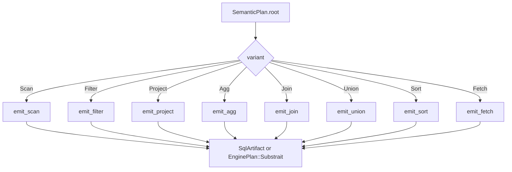

# Emit Pipeline Orchestrators

This leaf owns the adapt/emit pipeline orchestrators covering SQL-emission and Substrait-emission orchestration, per-variant rendering contracts, error propagation, AdaptErrorKind taxonomy, UnsupportedFeatureKind classifier, AdapterRegistry, crate boundaries, sandboxing/safety invariants, and the public API surface.

## 9. `adapt` / `emit` Pipeline

### 9.1 Structural overview

Both `adapt` and `emit` walk the same `SemanticPlan` tree and apply per-variant rendering. The flow per variant:



### 9.2 SQL-emission orchestrator (`crate::emit::emit_sql`)

```rust
/// Shared SQL orchestrator. Invoked by every SQL-emitting adapter's
/// `emit` method. Walks the plan tree, dispatches per-variant
/// rendering to `dialect`'s methods, and assembles the final
/// `SqlArtifact`. Returns the adapter's standard fail-fast tuple
/// shape: warnings (`PrecisionClamped` / `StructuralRewriteApplied` /
/// `SumOverflowRisk`) accumulate alongside a successful artifact;
/// the first fatal `AdaptErrorKind` short-circuits with the warnings
/// observed up to that point.
pub(crate) fn emit_sql<D: DialectEmit>(
    plan:     &SemanticPlan,
    manifest: &SemanticManifest,
    dialect:  &D,
    id:       AdapterId,
) -> Result<
    (SqlArtifact, Diagnostics<AdaptErrorKind>),
    (Diagnostic<AdaptErrorKind>, Diagnostics<AdaptErrorKind>),
>;
```

The orchestrator:

1. Walks `plan.root` bottom-up, producing a per-node SQL fragment (CTE-structured for non-trivial trees; flat `SELECT` for trivial single-source plans).
2. Consults `manifest` via each `ScanNode.source: SourceRef` to resolve the physical table / path / format per `15 §7.1`. Resolution produces the on-engine identifier the adapter quotes into the `FROM` clause. Non-table sources (files, globs) are rendered per each engine's syntactic conventions (DuckDB `read_parquet(...)`, DataFusion `CREATE EXTERNAL TABLE`, Spark `spark.read.parquet(...)` — the adapter owns the spelling).
3. At every `FunctionCall`, calls `dialect.rewrite_function(call)` and dispatches on `RewrittenCall`.
4. At every `Expr::Cast`, calls `dialect.emit_cast(inner, target)`.
5. At every identifier emission, calls `dialect.quote_identifier(name.as_str())`. No raw concatenation (§14).
6. Wraps the assembled text into `SqlArtifact { text, dialect: D::ID }` per `35 §7.3`.

### 9.3 Substrait-emission orchestrator (`crate::substrait::emit_substrait`)

```rust
/// Per `35 §10.2`'s mapping table. Each `PlanNode` variant maps to
/// exactly one `substrait::proto::Rel` kind. The free function emits
/// a complete `substrait::proto::Plan` together with any advisory
/// warnings; the caller wraps the proto in
/// `EngineArtifact::Plan(EnginePlan::Substrait(Box::new(plan)))` and
/// forwards the warnings to its tuple return.
pub(crate) fn emit_substrait(
    plan:     &SemanticPlan,
    manifest: &SemanticManifest,
) -> Result<
    (substrait::proto::Plan, Diagnostics<AdaptErrorKind>),
    (Diagnostic<AdaptErrorKind>, Diagnostics<AdaptErrorKind>),
>;
```

The orchestrator:

1. Walks `plan.root` bottom-up, emitting one `Rel` per `PlanNode` per the `35 §10.2` mapping.
2. Threads Substrait function-anchor registration per `adapter-roster.md §5.5`.
3. Round-trips `SemAnnotation` through `AdvancedExtension.optimization` per `35 §10.2`.
4. Serializes `output_names` into the plan's `RelRoot.names`.

### 9.4 Per-variant SQL rendering contracts

Every SQL-emitting `DialectEmit` provides (via default impls + targeted overrides) the following methods; the orchestrator calls them in the flow above. The full method surface is enumerated inline; default impls cover the ANSI-baseline form.

- `fn emit_scan(&self, src: &ResolvedPhysicalSource, cols: &[ResolvedColumn]) -> String` — default: `SELECT <cols…> FROM <table_name>`.
- `fn emit_filter(&self, child: &str, pred: &PhysicalExpr) -> Result<String, AdaptErrorKind>` — default: wraps `child` with `WHERE <pred>`.
- `fn emit_project(&self, child: &str, projs: &[(Name, PhysicalExpr)]) -> Result<String, AdaptErrorKind>`.
- `fn emit_agg(&self, child: &str, group_by: &[Name], aggs: &[(Name, AggregateExpr)]) -> Result<String, AdaptErrorKind>`.
- `fn emit_aggregate(&self, agg: &AggregateExpr) -> Result<String, AdaptErrorKind>` — the inner per-aggregate render; handles `distinct: true`, `FILTER (WHERE …)` (reserved per `35 §6.7`), and per-engine aggregate quirks.
- `fn emit_join(&self, left: &str, right: &str, ty: JoinType, card: Cardinality, on: &[KeyPair]) -> Result<String, AdaptErrorKind>` — per-engine `INNER`/`LEFT`/`RIGHT`/`FULL` rendering. `AsOf` routes through `emit_asof_join` (`dialect-emit.md §4.7`) when `supports_as_of()`.
- `fn emit_union(&self, inputs: &[String], distinct: bool) -> String` — `UNION ALL` / `UNION DISTINCT`.
- `fn emit_sort(&self, child: &str, order: &[(Name, SortDir)]) -> String` — uses `null_ordering_clause` per `dialect-emit.md §4.7`.
- `fn emit_fetch(&self, child: &str, limit: Option<u64>, offset: Option<u64>) -> Result<String, AdaptErrorKind>` — dialect-specific `LIMIT` / `FETCH FIRST` syntax per `registry/types_mapping.md §1`-adjacent conventions. Rejects values exceeding `i64::MAX` per `35 §5.9` as `AdaptErrorKind::FetchValueOutOfRange`.

Each method is a construction site per `31 §3.1` — returns the bare error kind; the orchestrator (§9.2 / §9.3) wraps into the stage-boundary `Diagnostic<AdaptErrorKind>` envelope alongside warning accumulation.

Each method carries a default ANSI-form impl; per-engine dialects override where the canonical rendering diverges (e.g. `emit_fetch` is overridden on DataFusion / DuckDB / Spark — they prefer `LIMIT n OFFSET m` over ANSI's `OFFSET m ROWS FETCH FIRST n ROWS ONLY`).

### 9.5 Error propagation

Any per-variant error fires the orchestrator immediately — fail-fast per `30 §7`. Partial SQL / partial Substrait is never returned. The failing node's `NodeMeta.node_id` (`35 §6.1`) is carried into the `Diagnostic<AdaptErrorKind>`'s `location` field at the orchestrator's wrapping point for post-hoc correlation. Any warnings accumulated up to the failure point ride alongside the fatal in the `Err((fatal, warnings))` tuple per the `30 §7` shape.

## 10. `AdaptErrorKind`

> **Migration note.** Body prose retains references to legacy `ADAPT_E_*` / `ADAPT_W_*` codes (e.g. `ADAPT_E_0302 UnsupportedFeature`, `ADAPT_W_0301 PrecisionClamped`). Those codes are **retired** per `30 §5`; the public-API surface identifies errors by `AdaptErrorKind` variant identity. The legacy code prefixes remain in body prose during the migration as cross-reference anchors and will be stripped in a follow-up doc pass. Read `ADAPT_E_NNNN VariantName` / `ADAPT_W_NNNN VariantName` in the body as shorthand for `AdaptErrorKind::VariantName`.

### 10.1 `AdaptErrorKind`

The following code block defines the AdaptErrorKind enum (first part):

```rust
/// Typed error-kind enum for `adapt` / `emit`. Identification by
/// variant identity per `30 §5`; numeric `ADAPT_E_*` codes have been
/// retired. `UnsupportedFeature` uses a `UnsupportedFeatureKind` sub-
/// classifier; per-flavor top-level variants are parked as
/// `Q-ADAPT-009`.
///
/// Severity is conveyed by `Diagnose::severity()` per `31 §3` —
/// most variants are `Error`; the per-engine advisory variants in the
/// `*Clamped` / `*RewriteApplied` / `*OverflowRisk` family are
/// `Warning` and surface through the `Diagnostics<AdaptErrorKind>`
/// channel in `adapt`'s tuple return (§3.1).
///
/// Source location lives in the `Diagnostic<AdaptErrorKind>` envelope,
/// not on this enum's variants.
#[non_exhaustive]
pub enum AdaptErrorKind {
    // -- Feasibility / capability --
    /// Plan references a dialect the adapter does not target.
    DialectMismatch         { expected: DialectId, got: Option<DialectId> },

    /// Adapter cannot produce a SQL artifact (non-SQL adapter, e.g.
    /// `SubstraitAdapter`, called via `emit`).
    EmissionNotSupported    { adapter: AdapterId },

    /// The plan uses a feature the adapter does not support. Primary
    /// kind for function / join-type / plan-node / annotation / type
    /// gaps. See `UnsupportedFeatureKind`.
    UnsupportedFeature      { feature: UnsupportedFeatureKind,
                              name:     String,
                              adapter:  AdapterId },

    /// `DialectEmit::type_name` / `emit_cast` raised an explicit
    /// unsupported-type error. Distinct from `UnsupportedFeature`
    /// because type gaps surface at a different layer (Binding
    /// reconciliation vs PlanNode emission).
    UnsupportedType         { ty:      DataType,
                              adapter: AdapterId,
                              context: &'static str },

    // -- Emission mechanics --
    /// Identifier quoting failed (e.g. embedded NULL byte,
    /// unrepresentable character). Rare; most pathological inputs are
    /// caught at `Name::new` (`35 §6.4`).
    IdentifierQuotingFailed { identifier: String, reason: &'static str },

    /// A `FetchNode.limit` / `.offset` value exceeds the adapter's
    /// representable range (typically `i64::MAX` for Substrait, or the
    /// engine's native `LIMIT` parse limit).
    FetchValueOutOfRange    { field: &'static str, value: u64, adapter: AdapterId },
```

The enum continues with additional error variants:

```rust
    /// An `AggregateExpr.filter` (`35 §6.7`) is populated but the
    /// adapter has no emission path for `FILTER (WHERE ...)`. All
    /// three first-class engines do; reserved variant covers future
    /// adapters that do not.
    AggregateFilterUnsupported { adapter: AdapterId },

    /// Structural plan mismatch detected during emission (e.g.
    /// `JoinNode.on` has a `KeyPair` referencing a column not in the
    /// child's schema). Not re-raised by default (planner is the
    /// authoritative validator, `35 §8`); fires only when the
    /// adapter's optional sanity check catches it.
    PlanStructureInvalid    { node_kind: &'static str, reason: String },

    // -- PlanBuilder-layer rewrite --
    /// Structural rewrite produced an expression that fails the
    /// generic emitter's invariants (bug in the adapter's rewrite;
    /// surfaces on debug builds with `debug_assertions`).
    RewriteInvariantViolated { source: String, target: String, reason: String },

    /// A `RegistryExtension`-contributed function resolved at compile
    /// but the adapter's own rewrite table has no entry for it.
    /// Surfaces only when an adapter-extended function registered by
    /// adapter X is called from adapter Y. Matches `14a §7.2`'s cross-
    /// adapter policy.
    AdapterExtendedFunctionCrossEngine {
        name:            String,
        owning_adapter:  AdapterId,
        calling_adapter: AdapterId,
    },

    // -- Substrait-specific --
    /// Substrait proto encoding failed. Wraps the `prost::EncodeError`
    /// as a string (`prost` is not on the public surface).
    SubstraitEncodeFailed   { reason: String },

    /// An `Expr` variant has no canonical Substrait anchor (e.g. a
    /// future `Expr` variant added before its URN lands).
    SubstraitAnchorMissing  { variant: &'static str },

    // -- Internal / adapter-bug --
    /// Generic SQL emission failure wrapping a lower-level string-
    /// build failure with no dedicated kind.
    EmitFailed              { reason: String, adapter: AdapterId },

    /// `adapt` was called with a plan whose
    /// `output_names.len() != root.meta().output_schema.len()`
    /// (`35 §3.2`). Planner bug reaching the adapter; re-raises as an
    /// adapter-layer error for trace-ability.
    OutputNamesMismatch     { expected: usize, got: usize },
```

The enum concludes with warning variants and supporting types:

```rust
    // -- Warning-severity advisories (per-engine adapter crates) --
    /// Per-engine type-precision was clamped (e.g. DuckDB timestamp
    /// precision truncation per `registry/types_mapping.md §3.3`).
    /// Severity::Warning. Surfaces through `adapt`'s warning slot.
    PrecisionClamped        { ty: DataType, adapter: AdapterId, reason: String },

    /// A structural rewrite was applied as a fallback (e.g. Spark's
    /// `string_agg` → `collect_list + array_join`). Severity::Warning.
    StructuralRewriteApplied { source_fn: String, target_form: String, adapter: AdapterId },

    /// `SUM(...)` over a tier the adapter promotes to a wider native
    /// type (e.g. DuckDB `HUGEINT` per
    /// `registry/functions_mapping.md §16.5`). Severity::Warning.
    SumOverflowRisk         { adapter: AdapterId, promoted_to: String },
}

/// Sub-classifier for `AdaptErrorKind::UnsupportedFeature`.
///
/// Per `Q-ADAPT-009`, promotion to top-level variants (one variant per
/// flavor) is deferred pending consumer feedback.
#[non_exhaustive]
pub enum UnsupportedFeatureKind {
    Function,       // FunctionCall name absent / blocked per §7.2 Unsupported tier
    JoinType,       // JoinType variant not supported (e.g. AsOf w/o capability)
    PlanNode,       // PlanNode variant not supported (e.g. future Distinct on
                    //   an adapter that lacks SQL rendering for it)
    Annotation,     // SemAnnotation variant not expressible on the emission target
    Dialect,        // caller requested a DialectId no registered adapter targets
    Cardinality,    // Cardinality variant carried on a JoinNode the adapter
                    //   cannot consume as a hint
}

impl semstrait_common::diagnostic::Diagnose for AdaptErrorKind {
    fn message(&self) -> std::borrow::Cow<'_, str>;
    fn severity(&self) -> semstrait_common::Severity {
        use AdaptErrorKind::*;
        match self {
            PrecisionClamped { .. }
            | StructuralRewriteApplied { .. }
            | SumOverflowRisk { .. } => semstrait_common::Severity::Warning,
            _ => semstrait_common::Severity::Error,
        }
    }
}
```

### 10.2 Variant identity, not codes

`AdaptErrorKind` is identified by **variant identity** per `30 §5`; the legacy
`ADAPT_E_0300`–`ADAPT_E_0499` / `ADAPT_W_0300`–`ADAPT_W_0499` reserved range
is retired alongside the workspace-wide stable-code retirement. SemVer
posture for variant identity:

- Renaming a variant is **MAJOR** (consumer pattern matches break).
- Adding a variant is **MINOR** (`#[non_exhaustive]` per §10.1; consumer
  exhaustive matches were already required to handle a wildcard arm).
- Adding a field to an existing variant's struct payload is **MINOR**
  (`#[non_exhaustive]` on each variant payload struct).
- Refining `Diagnose::message()` text is **PATCH** — consumers route on
  variant identity, not on `Display`/`message` strings.

The 16 v1 variants cover every Round-1 `ADAPT_E_*` code plus the three v1
warning advisories that were previously reserved-only (`PrecisionClamped`,
`StructuralRewriteApplied`, `SumOverflowRisk`). Per-engine adapter crates
contribute their advisory variants as PATCH/MINOR additions.

### 10.3 Warning posture

Warning-severity variants (`PrecisionClamped`, `StructuralRewriteApplied`,
`SumOverflowRisk`) flow through the same `Diagnose::severity()` channel as
errors but report `Severity::Warning`. The `adapt` / `emit` tuple return
shape (§3.1) carries them in the `Diagnostics<AdaptErrorKind>` slot — both
on the success arm (warnings accumulated alongside a successful artifact)
and on the failure arm (warnings accumulated up to the fatal point). Per-
engine adapter crates may add further warning variants without affecting
SemVer beyond the standard `#[non_exhaustive]` MINOR rule.

Adapters that produce no warnings return an empty `Diagnostics<_>` on the
success arm; consumers do not treat empty-warning success as a separate
shape.

## 11. Adapter Registration

### 11.1 `AdapterRegistry`

```rust
/// Process-global dispatch table. Maps `AdapterId` → `&'static dyn
/// EngineAdapter`. Sealed and immutable post-init. Per `Q-ADAPT-005`.
pub struct AdapterRegistry {
    /* crate-private: HashMap<AdapterId, &'static dyn EngineAdapter> */
}

impl AdapterRegistry {
    /// O(1) lookup by adapter id.
    pub fn get(&self, id: AdapterId) -> Option<&'static dyn EngineAdapter>;

    /// O(1) lookup by dialect id — returns the first-registered
    /// SQL-emitting adapter whose `dialect().map(|d| d.id()) == Some(id)`.
    /// For dialects with exactly one built-in adapter (v1 default),
    /// this is deterministic.
    pub fn get_by_dialect(&self, id: DialectId) -> Option<&'static dyn EngineAdapter>;

    /// Iterate every registered adapter.
    pub fn entries(&self) -> impl Iterator<Item = (AdapterId, &'static dyn EngineAdapter)>;
}
```

No mutation API — once the registry seals at first-access, no registration / deregistration happens. Matches `FunctionRegistry`'s posture (`31 §5.2`).

### 11.2 Process-global accessor

```rust
/// Returns the process-global, sealed adapter registry. Initialized
/// lazily via `OnceLock` on first call; subsequent calls return the
/// same `&'static`. Per `Q-ADAPT-005`.
///
/// Bundled adapters (`AnsiSqlAdapter`, `SubstraitAdapter`) are always
/// registered. Per-engine crates contribute their adapters via the
/// `AdapterContribution` trait (§11.3); wiring mechanism mirrors
/// `[TD-REGISTRY-EXTENSION-WIRING]` of `14a §7.1` — the registry
/// initializer's seed list is either a build.rs-generated aggregation
/// or a feature-gated static array.
pub fn adapter_registry() -> &'static AdapterRegistry;
```

### 11.3 `AdapterContribution`

```rust
/// Analog of `RegistryExtension` (`14a §7.1`) for adapter registration.
/// Each per-engine crate impls on a zero-size marker and contributes
/// a `&'static dyn EngineAdapter`.
pub trait AdapterContribution {
    const ADAPTER: &'static dyn EngineAdapter;
}
```

Third-party adapter crates outside the workspace (`semstrait-adapter-trino`, `semstrait-adapter-clickhouse`, …) impl this trait on their own marker; the process's `adapter_registry()` folds every linked `AdapterContribution` at startup.

### 11.4 Dispatch at the API boundary

`semstrait-api` (`38`) consumes the registry to resolve a `Session::adapt(adapter_id, plan, manifest)` call:

```rust
// Sketch — 38 owns the final signature.
impl Session {
    pub fn adapt(
        &self,
        adapter_id: AdapterId,
        plan:       &SemanticPlan,
        manifest:   &SemanticManifest,
    ) -> Result<
        (EngineArtifact, Diagnostics<AdaptErrorKind>),
        (Diagnostic<AdaptErrorKind>, Diagnostics<AdaptErrorKind>),
    > {
        let adapter = adapter_registry().get(adapter_id).ok_or_else(|| {
            (
                Diagnostic::error(AdaptErrorKind::UnsupportedFeature {
                    feature: UnsupportedFeatureKind::Dialect,
                    name:    adapter_id.as_str().into(),
                    adapter: adapter_id,
                }),
                Diagnostics::empty(),
            )
        })?;
        adapter.adapt(plan, manifest)
    }
}
```

Per-session allow-lists (e.g. "this read-only session can only use `duckdb-sql`") layer on top of the global registry per `Q-ADAPT-005`; the underlying registry remains global.

## 12. Stability

### 12.1 Stable parts

- **`EngineAdapter` trait is OPEN.** Third-party adapter crates outside the workspace MUST be able to impl `EngineAdapter` without a sealed-trait escape hatch (`30 §8.2`). Adding a new method with a default body is MINOR; adding a required method is MAJOR; removing a method is MAJOR.
- **`DialectEmit` trait is OPEN.** Same posture as `EngineAdapter`. Adding a new method with a default body (e.g. `emit_grouping_sets`) is MINOR.
- **Built-in `Dialect` implementations stable across v1** — `AnsiDialect`, `DataFusionDialect`, `DuckDbDialect`, `SparkDialect`. Their emission output is tested byte-for-byte against a snapshot fixture per `§14.6`; a MINOR release MAY NOT change the rendering of a plan that did not change canonical representation between versions. Matches `30 §11.4`'s "behavior-preserving refactors" rule.
- **`AdapterId` / `DialectId` const additions are non-breaking** (MINOR per `30 §11.1`).
- **`AdapterCapabilities` predicate additions are non-breaking** (method addition is MINOR per `30 §2.1`).
- **`Capability` variant additions are non-breaking** (`#[non_exhaustive]` per `35 §12.6`; type definition in `35`, per-adapter roster authority in `36` per Q-IR-010 / `Q-ADAPT-007`).
- **`AdaptErrorKind` variant additions** are non-breaking (`#[non_exhaustive]` per `10.1`; identification by variant identity per `30 §5`).
- **The Substrait mapping** (per `35 §10.2`) is stable across v1; changes require a MINOR release of `semstrait-ir` AND a MINOR release of `semstrait-adapter` in lock-step per `30 §2.1`.

### 12.2 Internal parts

- **The internal orchestrator (`crate::emit::emit_sql`, `crate::substrait::emit_substrait`)** is `pub(crate)`; non-workspace consumers don't see it. Adapter crates reach it through the `EngineAdapter` trait surface, not through direct function calls.
- **Exact per-adapter rewrite tables** — adapter crates MAY refine their tier tables within a MINOR release; the observable contract is the rendered output, not the tier classification. A rewrite that moves from Name-only to Name-remap without changing observable output is PATCH per `30 §11.4`.
- **Diagnostic wording** — every `Diagnose::message()` rendering for `AdaptErrorKind` may be refined in PATCH; consumers route on variant identity, not on `Display` / `message` text.

### 12.3 Per-engine crate versioning

Per `30 §13`, per-engine adapter crates (`semstrait-adapter-datafusion`, `-duckdb`, `-spark`, `-substrait`) are **Provisional** and versioned **independently**. Their stability tiers follow each crate's own maturity; a `semstrait-adapter` MINOR does not automatically force a per-adapter-crate MINOR. Whether per-adapter crates pin `semstrait-adapter` exactly or float within a MINOR band is parked as `Q-ADAPT-006`.

## 13. Crate Boundaries

### 13.1 What `semstrait-adapter` does NOT do

- **No I/O.** No filesystem, no network, no catalog-provider calls. Concrete I11 guarantee. Adapters are pure in-memory transformations. Running the emitted artifact against a live engine is an executor shim one layer above `semstrait-adapter`.
- **No catalog.** `SemanticPlan`'s `SourceRef`s resolve against the `SemanticManifest` the adapter receives by borrow; the adapter does not consult `semstrait-catalog`. Any drift between the SemanticManifest's `ResolvedPhysicalSource` and a live engine's schema is the caller's concern (narrow drift-check per `00 §9` I11, outside `adapt`).
- **No planning.** `semstrait-adapter` does not strategize over `Request` / `SemanticManifest`. It consumes a finalized `SemanticPlan` and emits. Per `34`, the planner is the sole producer.
- **No optimization.** Rule-based rewrites over `SemanticPlan` live in `semstrait-planner` per `34`. The PlanBuilder-layer rewrites of §4.5 are engine-specific structural rewrites of individual `FunctionCall` nodes, NOT cost-based or rule-scheduled optimization passes over the plan tree.
- **No SemanticManifest construction.** Consumes `SemanticManifest` by borrow; never builds one.
- **No authoring-layer YAML.** Never parses Model YAML, never sees the authoring expression surface (the friendly field-level projection, `14 §6`); only `PhysicalExpr` flows through.

### 13.2 Dependency posture

Per `Cargo.toml`, `semstrait-adapter` depends on:

```toml
[dependencies]
semstrait-common     = { path = "../semstrait-common" }
semstrait-ir       = { path = "../semstrait-ir" }
semstrait-manifest = { path = "../semstrait-manifest" }  # borrow-only use
thiserror          = "^"
prost              = "^"                                 # for substrait::proto encoding
substrait          = "^"                                 # proto types consumed from 35

[dependencies.serde]
version  = "^"
optional = true
features = ["derive"]

[features]
default = []
serde   = ["dep:serde", "semstrait-ir/serde", "semstrait-common/serde"]
```

**No runtime-only dependencies.** No `tokio`, `async-trait`, `futures`, `reqwest`, `hyper`, `sqlx`.

**No engine dependencies.** No `datafusion`, no `arrow`, no `duckdb`, no `spark-*` in the shared crate. Those live in per-engine crates (`semstrait-adapter-datafusion` depends on `datafusion` + this crate; `semstrait-adapter-duckdb` on `duckdb` + this crate; etc.) per `30 §10.2`.

**Workspace dependencies** are limited to `semstrait-common`, `semstrait-ir`, `semstrait-manifest`. `semstrait-model` is reached transitively through `semstrait-ir` (item Y / V1 `ir -> model` edge) and is not a direct edge. Adding a *direct* dependency on `semstrait-model`, or any dependency on `semstrait-planner`, `semstrait-catalog`, or `semstrait-api`, is a CI-enforced failure per I7.

## 14. Sandboxing / Safety

### 14.1 SQL injection — threat model

The emitter receives `SemanticPlan` values that are NOT necessarily trusted:

- `Name` values were validated at `Name::new` (`35 §6.4`) and are empty-rejected + reserved-prefix-rejected.
- `Literal::String(_)` values come from author-written YAML or from planner-substituted request parameters (`SessionContext` values). Both can contain arbitrary bytes including SQL-delimiter characters.
- `ResolvedColumn.name` values come from SemanticManifest resolution (`15 §4.2`) and are catalog-derived — typically well-formed but may contain engine-specific special characters depending on source.
- `SourceRef` resolves to a `ResolvedPhysicalSource` whose `table_name` / `path` fields are catalog-derived. Same trust model.

### 14.2 Mandatory quoting

**Every identifier emitted into `SqlArtifact.text` MUST pass through `DialectEmit::quote_identifier`.** String-concatenating an identifier raw into SQL text is a soundness bug, not a style violation. The internal orchestrator (§9.2) enforces this discipline: every column reference, table reference, CTE label, and alias emits via `quote_identifier`. Per-adapter overrides that want a "fast path" for known-safe names are rejected — the quoting cost is negligible and the safety benefit is absolute.

**Every string literal emitted MUST pass through `DialectEmit::escape_string_literal`.** The default impl doubles internal single-quotes per ANSI. Engines with non-standard escape rules (none at v1) override.

### 14.3 Trusted-path literals

Numeric / boolean / date / timestamp literals go through `DialectEmit::quote_literal` without escape handling — their canonical rendering contains no delimiter characters by construction. `Literal::Decimal` values arrive as pre-validated `String` per `31 §3.5`'s decimal shape; the adapter emits the underlying digits directly (no escaping needed, no delimiter characters possible).

### 14.4 Binary literals

`Literal::Binary(Vec<u8>)` renders per-engine:

- ANSI / DataFusion / DuckDB: `X'<hex>'` (hex-encoded byte string).
- Spark: `unhex('<hex>')` (function-call form).

Binary literals can never introduce SQL injection because the hex encoding rejects any byte that's not in `[0-9a-fA-F]`; the adapter refuses to emit a binary literal from an input that has already-invalid bytes (impossible — `Vec<u8>` is any byte sequence; hex encoding is unconditional).

### 14.5 Regex / LIKE pattern literals

`Expr::RegexpMatch`, `Expr::RegexpExtract`, `Expr::Like`, `Expr::ILike` carry their pattern as a `PhysicalExpr` — which, when it's a `Literal(String(...))`, routes through `escape_string_literal`. There is no "regex-specific quoting" at the SQL layer; the SQL-level escaping is the only defense. Per-engine regex flavor divergence (RE2 vs ICU vs Java Pattern) is out of scope per `registry/functions_mapping.md §11` — the adapter emits the pattern verbatim (after SQL-layer escape); interpretation is engine-side.

### 14.7 Injection invariants

Upheld across every `impl EngineAdapter`:

- **SI-1 — no raw-identifier concatenation.** Every identifier passes through `quote_identifier`. Enforced by the internal orchestrator + a release audit scanning adapter source for raw-String `format!("{}", col_name)` patterns outside quoting helpers.
- **SI-2 — no raw-literal concatenation.** Every string literal passes through `escape_string_literal` or `quote_literal`. Same audit scope.
- **SI-3 — delimiter invariants hold per dialect.** Each `DialectEmit` impl documents its quote / escape character set; the audit suite validates round-trip for every fixture across every built-in adapter.
- **SI-4 — `SourceRef` resolution does not bypass quoting.** SemanticManifest-derived identifiers (table_name, path segments) pass through the same `quote_identifier` path. No "trust the catalog" exemption.

## 15. Public API Surface Sketch

### 15.1 `adapter`

```
pub trait  EngineAdapter                                 // id, dialect, capabilities, adapt, emit
pub struct AdapterId                                     // newtype; pub const ANSI_SQL | ... | SUBSTRAIT
pub fn     debug_sql(&SemanticPlan, &SemanticManifest) -> Result<String, AdaptErrorKind>
```

### 15.2 `dialect`

```
pub trait  DialectEmit : Dialect                         // operational SQL rendering
pub struct AnsiDialect                                   // baseline
pub struct AnsiSqlAdapter                                // baseline adapter
pub enum   RewrittenCall                                 // NameOnly | Remapped | Structural
```

### 15.3 `dialect::quoting`

```
// pub(crate) — exposed only through DialectEmit methods.
pub(crate) fn quote_ansi_identifier(&str) -> String
pub(crate) fn escape_ansi_string_literal(&str) -> String
```

### 15.4 `capabilities`

```
pub struct AdapterCapabilities                           // capability slice + predicate shortcuts
pub use    semstrait_ir::Capability                      // re-export per 35 §12.6
```

### 15.5 `substrait`

```
pub struct SubstraitAdapter                              // non-SQL adapter; emits EnginePlan::Substrait
// pub(crate) emit_substrait(&SemanticPlan, &SemanticManifest) -> Result<substrait::proto::Plan, AdaptErrorKind>
```

### 15.6 `registry`

```
pub struct AdapterRegistry                               // sealed, &'static
pub trait  AdapterContribution                           // ADAPTER const
pub fn     adapter_registry() -> &'static AdapterRegistry
```

### 15.7 `error`

```
pub enum   AdaptErrorKind                                // 16 variants v1 (13 error + 3 warning advisory); identification by variant identity per `30 §5`
pub enum   UnsupportedFeatureKind                        // Function | JoinType | PlanNode | Annotation | Dialect | Cardinality
impl       semstrait_common::diagnostic::Diagnose for AdaptErrorKind
```

### 15.8 Crate-root re-exports

```rust
// lib.rs
pub use crate::adapter::{EngineAdapter, AdapterId, debug_sql};
pub use crate::dialect::{DialectEmit, AnsiDialect, AnsiSqlAdapter, RewrittenCall};
pub use crate::capabilities::AdapterCapabilities;
pub use crate::substrait::SubstraitAdapter;
pub use crate::registry::{AdapterRegistry, AdapterContribution, adapter_registry};
pub use crate::error::{AdaptErrorKind, UnsupportedFeatureKind};

// Re-exports from semstrait-ir that `36`-authoritative surfaces rely on:
pub use semstrait_ir::{
    Capability, Dialect, DialectId,
    EngineArtifact, EnginePlan, SqlArtifact,
};
```

## Testing Strategy

- SQL orchestrator emit_sql (CTE-structured, flat SELECT per §9.2)
- Substrait orchestrator emit_substrait (per 35 §10.2 mapping per §9.3)
- Per-variant SQL rendering (emit_scan through emit_fetch per §9.4)
- Error propagation (fail-fast, NodeMeta.node_id in location per §9.5)
- AdaptErrorKind 16 v1 variants (13 error + 3 warning per §10.1)
- UnsupportedFeatureKind sub-classifier (6 variants per §10.1)
- Variant identity not codes (ADAPT_E_*/ADAPT_W_* retired per §10.2)
- Warning posture (Severity::Warning per §10.3)

See the shared behavioral harness: [`../../testing/50_behavioral_contract_gates.md`](../../testing/50_behavioral_contract_gates.md)
