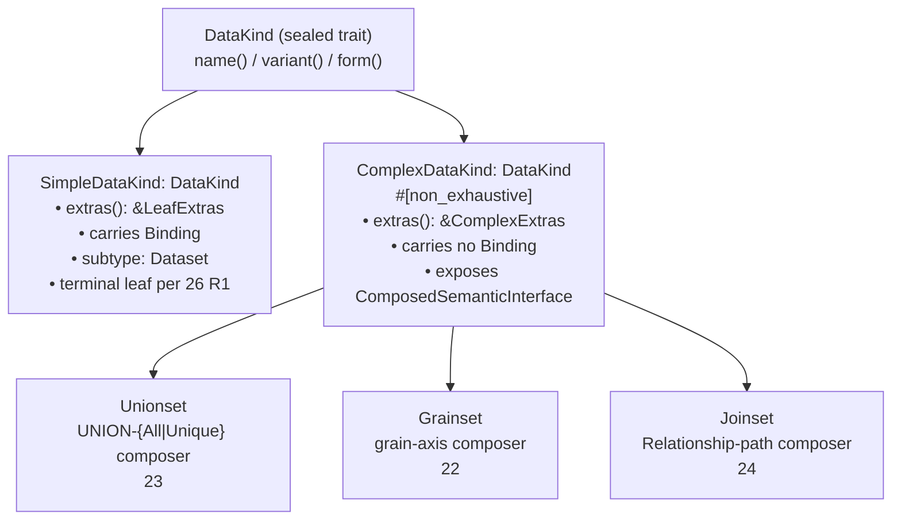

# DataKind Taxonomy — Trait Hierarchy, Variants & Shared Invariants

This leaf ratifies the `DataKind` sealed-trait hierarchy over two orthogonal axes (structural `Simple`/`Complex`, behavioral `Public`/`Nested`) across the four V1 variants, the four-variant-at-a-glance matrix, and the shared DataKind invariants D1–D8.

> **Reconciliation.** The concrete per-variant Rust-struct / YAML-surface shape is ratified across:
>
> - [`../apis/32_semstrait_model.md §3`](../../apis/32_semstrait_model.md) — top-level plural YAML tags; `DataKindBase<E>`; `DatasetBody` / `GrainsetBody` / `UnionsetBody` / `JoinsetBody`; `Public*` / `Nested*` concrete types; the **sealed `DataKind` trait hierarchy**; per-form view enums.
> - [`../apis/32_semstrait_model.md §4`](../../apis/32_semstrait_model.md) — the `LeafExtras` / `ComplexExtras` shapes (the type-level expression of "leaf-only" for `catalog` / `storage` / `semantic_mapping`).
> - [`../foundations/18_entities.md`](../../foundations/18_entities.md) — canonical entity types: `SemanticInterface`, `TemporalShape`, `SemanticMapping`, `Keys`, `AiContext`, `Relationship`.
> - [`26_nesting_matrix.md`](../26_nesting_matrix.md) — nesting rules R1 / R2 / R3.
> - [`../apis/32b_catalogs_yaml.md`](../../apis/32b_catalogs_yaml.md) — `CatalogRef` grammar consumed via `extras.catalog:` (leaf-only).
>
> `20` retains authority for: the taxonomy (§2), the variant-level contract surface (§2.2), shared invariants (§4), the `Strategy` trait surface and dispatch contract (§5), the per-stage responsibility skeleton (§6), and the shared error-code roster (§8).

## 1. Purpose and Scope

`20` is the foundations-adjacent document that ratifies the **shared variant-level abstraction** sitting on top of `15`'s binding layer and `16`'s composition layer. It is the first document in the `data-kinds/` sub-tree; everything in `21`–`25` inherits from `20`'s invariants and refines them for one concrete variant or for a cross-variant matrix.

`20` does **not** ratify per-variant block shape (`12 §3`–`§5`), per-variant resolution algorithms (`21`–`24`), per-variant YAML surface (`32`), the `ComposedSemanticInterface` internals (`16 §5`), the `Relationship` block (`16 §2`), or SemanticManifest-layer struct rosters (`33`).

### 1.1 Guardrails — how `20` upholds `00 §9` invariants

| Invariant | Where `20` keeps it |
|---|---|
| **I5** — resolution is compile-time | Every variant's structural / reference / binding / composition work happens in `parse` / `validate` / `compile` per §6. Plan time sees only a ratified trait surface. |
| **I6** — `plan` is synchronous | The `Strategy` trait (§5.2) returns `Result<PlanNode, PlanError>` with no `async`. Strategy dispatch (§5.3) is a single `match` on `DataKindVariant`. |
| **I8** — SemanticManifest is planner-complete | Every per-variant field the planner needs is materialized by `compile` (§6.3). |
| **I10** — public sum types are `#[non_exhaustive]` | `DataKindVariant` and `DataKindForm` (per `32 §3.4`), the per-form view enums (per `32 §3.6`), and every `*_E_2xxx` error variant carry `#[non_exhaustive]`. The `ComplexDataKind` extension axis is itself non-exhaustive at the trait level. |
| **I12** — diagnostics carry stable codes | Every §8 entry has a `{SUBSYSTEM}_{SEVERITY}_{NUMBER}` code matching `30 §6.1`'s format; ranges are reserved per `30 §6.2`. |

I1 / I2 / I3 / I4 / I7 / I9 / I11 apply transitively — `20`'s surface exposes no raw SQL, no physical types, no engine identity, no I/O-at-plan, and sits at layer `2x` which only crates above the `1x` layer consume.

---

## 2. The `DataKind` Abstraction

### 2.1 `DataKind` as a sealed trait hierarchy

The `DataKind` abstraction is exposed as a **sealed trait hierarchy**, not a public sum type. Concrete types — `Dataset` plus the three composer variants `Grainset` / `Unionset` / `Joinset`, each in `Public*` and `Nested*` form — implement a base `DataKind` trait plus exactly one trait on each of two orthogonal axes:

- **Structural axis** — `SimpleDataKind` (leaf, carries `Binding`, owns `LeafExtras`) vs `ComplexDataKind` (composer, carries no `Binding` of its own, owns `ComplexExtras`). V1 subtypes: `SimpleDataKind` covers `Dataset` / `NestedDataset`; `ComplexDataKind` covers the three composer variants in both forms. The `ComplexDataKind` axis is `#[non_exhaustive]` per I10.
- **Behavioral axis** — `PublicDataKind` (top-level, queryable; exposes `description` / `ai_context` / `semantic_interface`) vs `NestedDataKind` (structural shell; body-only, no Public-form fields).

The sealed-trait declarations (`mod sealed`, base `DataKind`, the four sub-traits, the `DataKindVariant` / `DataKindForm` tag enums, and the per-form view enums for heterogeneous iteration) are ratified at [`32 §3.4`](../../apis/32_semstrait_model.md). At the SemanticManifest layer (`33`), the same two-axis hierarchy appears as `ResolvedSimpleDataKind` / `ResolvedComplexDataKind`.

> **Phase 3 amendment (2026-05-28; cascade from CCK + C9.5).** [`../apis/33_semstrait_manifest.md §6`](../../apis/33_semstrait_manifest.md) persists a **flat closed `DataKindVariant { Dataset, Unionset, Grainset, Joinset }`** that mirrors D9 (variant-to-strategy total mapping). `33` owns the manifest-resident `DataKind` primitive shape (id + name + role + origin + coverage + variant); `20` owns the canonical taxonomy and the sealed-trait authoring surface. The two are intentional duals: the model layer uses sealed traits for type-level discipline; the manifest layer uses a closed enum mirror for serialisation and id-keyed collection storage. Per C9.5, the manifest's `DataKind` carries an `origin: DataKindOrigin { Explicit, Implicit }` discriminator distinguishing author-declared kinds from compile-synthesised kinds (notably the multi-source-Dataset auto-Unionset of `21 §3.2` / `23 §2.1` row A). `Origin` is diagnostic-only; runtime semantics are identical across the two values.

#### 2.1.1 Diagram — the `DataKind` taxonomy tree

The behavioral axis (`PublicDataKind` / `NestedDataKind`) is orthogonal — every concrete leaf appears in two forms (Public top-level, Nested structural shell); the trait implementation matrix at `32 §3.5` is the canonical 8-row × 3-axis cross-product.

A concrete value implements exactly one of `SimpleDataKind` / `ComplexDataKind`, and exactly one of `PublicDataKind` / `NestedDataKind`.

### 2.2 Mandatory trait surface — what every DataKind variant exposes

The minimal trait every concrete variant exposes is the sealed `DataKind` trait plus exactly one trait on each of the two orthogonal axes (structural × behavioral). The full signatures are ratified at [`32 §3.4`](../../apis/32_semstrait_model.md).

The contract surface is **read-only**:

- `name()` / `variant()` / `form()` on the base.
- `extras()` on each structural-axis trait — returns `&LeafExtras` on `SimpleDataKind`, `&ComplexExtras` on `ComplexDataKind` (per `32 §4`).
- `description()` / `ai_context()` / `semantic_interface()` on `PublicDataKind` only.
- `allowed_child_variants()` / `child_count()` / `children_ref()` on `ComplexDataKind`.

Pattern-matching on the variant tag is restricted to the planner's strategy-dispatch site (§5.3) and per-variant match arms inside `21`–`24`. Most generic planner / validator code consumes the trait, not the tag.

**Lifecycle hooks (validate / compile / strategy) live outside the trait hierarchy.** They are stage-owned operations on borrowed concrete types or `*Ref` view enums (`32 §3.6`):

- **Validate-stage hooks** at `10 §3` plus the `SR-E-*` rules in `18 §11` and per-variant rules in `22`–`24`.
- **Compile-stage hooks** at `15 §10` (Simple) and `16 §5` / `§10.1` (Complex).
- **Strategy dispatch** at `34` and the four per-variant strategies in `21`–`24`.

What the contract surface does **not** carry: no `Binding` accessor on `ComplexDataKind`; no `CompositionKind` accessor on `SimpleDataKind`; no Public-form fields on `NestedDataKind`-implementing types; no runtime `NestingCapability` flag struct (the legality matrix is `26 §1`'s table, type-level enforced via per-`*Body` child-vector field sets at `32 §3.2`).

### 2.3 Simple vs Complex — the leaf-vs-composer split

#### 2.3.1 `Binding` lives on `SimpleDataKind` exactly

> **Invariant D1 — single-binding-on-Simple.** A `Binding` may appear in the `SemanticModel` at exactly one position: the `binding:` field of a `SimpleDataKind`. A `ComplexDataKind` YAML block containing a `binding:` key is a structural error (`VALID_E_2001 BindingOnComplex`).

This is the type-level reason `Binding` is reachable only from `SimpleDataKind`-implementing concrete types per `32 §3.4` — `ComplexDataKind` has no `binding()` method by design.

#### 2.3.2 Interface exposure — bare vs composed

Per `00 §4.1`:

- `Simple` exposes a **bare** `SemanticInterface` — the set of `Semantics` declared directly on the leaf (per `11 §6`).
- `Complex` exposes a **`ComposedSemanticInterface`** — the unified view of constituents (`16 §5`).

`ComposedSemanticInterface` is structurally distinct from `SemanticInterface` (`16 §5.1`); both implement a `SemanticsView` trait. The model-layer `PublicDataKind::semantic_interface()` accessor returns `&SemanticInterface` for every Public variant; the variant-specific composed-interface materialization is a SemanticManifest-layer concept produced at compile per `16 §5` / `§10.1`.

> **Phase 3 amendment (2026-05-28; cascade from C7.4 + C8.2).** The persistence contract in [`../apis/33_semstrait_manifest.md`](../../apis/33_semstrait_manifest.md) carries **coverage primitives only** for Complex variants — per-Joinset-hop `hop_coverage`, per-Grainset-level `level_coverage`, per-Unionset-branch `branch_coverage`, plus the universal top-level `coverage: SemanticBitmask` (CCK.1). The composed `ComposedSemanticInterface` (`UnifiedSemantics` + `FieldProvenance` + `CompositionCoverage`) is **not** persisted; `SemanticGraph` synthesises it at build time from the manifest's primitives. Spec `20`'s D5 invariant remains canonical at the taxonomy level — Complex variants conceptually expose a `ComposedSemanticInterface` — but the materialisation site is graph build, not manifest load. See `33 §6.6` (Grainset variant) and `33 §6.7` (Joinset variant) for the cascaded notes.

#### 2.3.3 Composer-without-own-Semantics rule

Per `11 §2` / `11 §10`, nested DataKinds do **not** declare their own Semantics; only the top-level DataKind's interface is authoritative. A nested `ComplexDataKind` (e.g. a `NestedUnionset` inside a `Grainset` body) implements `NestedDataKind`, not `PublicDataKind` — it has no `semantic_interface()` accessor; the access path is through its parent's composed interface.

---

## 3. The Four Variants at a Glance

| Aspect | `Simple` / Dataset (`21`) | `Unionset` (`23`) | `Grainset` (`22`) | `Joinset` (`24`) |
|---|---|---|---|---|
| **Composes children?** | No — terminal leaf per `26 §1` (R1). | Yes — ≥ 2 branches per `26 §1` (R3). | Yes — ≥ 2 levels per `26 §1` (R3). | Yes — exactly 2 members in v1 per `12 §5.3` (N-ary deferred as `TD-NESTING-NARY-JOIN`). |
| **Carries own `Binding`?** | Yes — exactly one, per `15 §2.1` / `§2.3.1`. | No — aggregates branch Bindings. | No — aggregates per-level child Bindings. | No — aggregates member Bindings. |
| **Interface exposed** | `SemanticInterface` (bare). | `ComposedSemanticInterface` with `CompositionKind::Unionset` (`16 §5`). | `ComposedSemanticInterface` with `CompositionKind::Grainset`. | `ComposedSemanticInterface` with `CompositionKind::Joinset`. |
| **Grain-aware at resolution?** | No — fixed grain per source. | No — union over branches at the branch's own grain. | **Yes** — level selection is grain-driven (`22 §*` / `13 §*`). | No — join semantics are grain-agnostic at the Joinset level. |
| **Uses declared `Relationship`s?** | No. | No — branches are unioned. | No — levels are grain-stacked. | **Yes** — `path:` references a declared `Relationship`; mandatory from `16 §9` for cross-Relationship spans. |
| **Request fan-out rule** | 1:1 — one `Scan` per PhysicalSource (`15 §3`). | 1:N union branches `UNION ALL`-ed per `23 §*`. | 1:1 level selection — one Request resolves to one level's child subtree. | 1:1 join — one Request resolves to one join tree over the members on the `path:`. |
| **Coverage model** | Binding-level `Coverage` (`15 §6`). | Composition-level `CompositionCoverage` (`16 §8`) with NULL-fill for gaps. | Composition-level `CompositionCoverage` with per-level coverage folding. | Composition-level `CompositionCoverage` with join-path provenance. |
| **TemporalShape interaction** | Shape declared inline (`00 §4.1` / `17`). | Branches may have heterogeneous shapes; planner advisories per `17 §*`. | Shape-gated level eligibility per `17 §*`. | `AsOf` join variant gated on `TemporalShape` (currently DEFERRED). |
| **Same-variant self-nesting** | N/A. | Banned (`26 §1` R2). | Banned. | Banned. |
| **Materialization in SemanticManifest** | `ResolvedSimpleDataKind` with `ResolvedBinding` (`15 §10`). | `ResolvedComplexDataKind` with composed interface (`16 §10.1`). | Same. | Same — Joinset is **explicit** composition (`16 §9`). |
| **Strategy (§5)** | `SimpleStrategy` (`21`). | `UnionsetStrategy` (`23`). | `GrainsetStrategy` (`22`). | `JoinsetStrategy` (`24`). |

---

## 4. Shared Invariants

The invariants below hold for every DataKind variant. D1 was ratified in §2.3.1.

### 4.1 Naming

> **Invariant D2 — global identity of DataKind names.** A top-level DataKind's name is globally unique within the Model's Root scope (`11 §2` / `11 §3`). No two top-level DataKinds may share a name. Nested DataKinds bear structural labels per `11 §10.3`; structural labels are NOT DataKind names.

Names follow the ASCII-only identifier grammar in `11 §4`. The Request-side `from:` field references a top-level DataKind by this global name; field-first resolution (`16 §11`) ignores structural labels.

### 4.2 Lifecycle — shared stage skeleton

Every variant participates in the six-stage pipeline ratified in `10 §2`:

| Stage | Shared responsibility | Per-variant specialization |
|---|---|---|
| `parse` | Parser recognizes the variant's YAML discriminator (`datasets:` / `unionsets:` / `grainsets:` / `joinsets:`) and emits a `SemanticModel` node tagged with the variant. | Per-variant YAML shape (`12 §3`–`§5`); per-variant `ParseError`s in `PARSE_E_02xx` (`30 §6.2`). |
| `validate` | Validator dispatches per-variant structural rules (per `10 §3`). Variant-independent Preconditions run in parallel with variant-specific ones; diagnostics accumulate per `10 §5`. | `26 §1`, `26 §2.3`, and every variant-specific rule in `21`–`24`. |
| `compile` | Compiler runs per-variant resolution: Simple per `15 §10`; Complex constituent-resolution + composed-interface synthesis per `16 §5` / `§6` / `§10.1`. Produces `ResolvedSimpleDataKind` / `ResolvedComplexDataKind` and registers in `DataKindIndex` (`33`). | Simple resolves a single Binding; Unionset folds branch coverage; Grainset folds per-level coverage; Joinset walks declared path and synthesizes a materialized composed surface. |
| `plan` | Strategy dispatch (§5.3) → `Strategy::resolve` → result splicing into `SemanticPlan`. Synchronous (I6); no I/O (I11). | Per-variant `Strategy::resolve` algorithm in `21`–`24`. |
| `optimize` | Variant-agnostic — rules declared at `PlanNode` level (`10 §5.4`). | None. |
| `adapt` | Variant-agnostic — adapter lowers `PlanNode` to `EngineArtifact` (`10 §5.5`). | None. |

> **Invariant D3 — every DataKind variant owns a compile-time materialization.** By the end of `compile`, every top-level DataKind in the input `SemanticModel` has produced a corresponding `ResolvedDataKind` in the SemanticManifest.

### 4.3 Coverage surface

| Variant | Coverage layer | Source |
|---|---|---|
| `Simple` | Binding-level `Coverage` (`Native` / `NullFill` / `Derived` / `Metadata`). | `15 §6`. |
| `Unionset` / `Grainset` / `Joinset` | Composition-level `CompositionCoverage` keyed by `(ConstituentRef, SemanticsName)`. | `16 §8`. |

> **Invariant D4 — coverage is always present.** Every `ResolvedDataKind` carries a coverage surface. A `ResolvedDataKind` with no coverage surface is malformed — `COMP_E_2005 MissingCoverage`.

> **Phase 3 amendment (2026-05-28; cascade from CCK.1).** The manifest-resident realization of D4 is the universal top-level `coverage: SemanticBitmask` field on every `DataKind` per [`../apis/33_semstrait_manifest.md §6.1`](../../apis/33_semstrait_manifest.md). `33` owns the persisted shape (`EntityId`-keyed `data_kinds: BTreeMap<EntityId, DataKind>` plus per-variant local coverage masks on `DataKindVariant`); `20` owns the canonical taxonomy and the coverage-always-present invariant. The persisted `coverage` is the union view; per-constituent `*Bitmask` (e.g., `branch_coverage`, `level_coverage`, `hop_coverage`) live on the variant struct per CCK.3.

### 4.4 Interface exposure

> **Invariant D5 — `Simple` exposes `SemanticInterface`; every `Complex` variant exposes `ComposedSemanticInterface`** at the SemanticManifest layer. The mapping is variant-determined and irrevocable.

Request-side field-first resolution (`16 §11`) may form an implicit `ComposedSemanticInterface` **at plan time** when a Request's Semantics span multiple top-level DataKinds connected by declared `Relationship`s. This is plan-time synthesis, not a DataKind-level interface exposure.

### 4.5 Grain posture

> **Invariant D6 — `Grain`-awareness is a per-variant property.** `Simple` / `Unionset` / `Joinset` are **not grain-aware** at the DataKind level — they carry their constituents' intrinsic grain without rollup. `Grainset` **is grain-aware** — it stacks the same logical DataKind across multiple `Grain` levels, and its `Strategy` selects a level at plan time.

`TemporalShape` (`17`) constrains grain-rollup legality on each variant; `17` is the ratifying doc.

### 4.6 Nesting rules

> **Invariant D7 — nesting legality is exclusively ratified by `26 §1`'s matrix.** Each `*Body`'s child-vector field set (`32 §3.2`) is the type-level projection of that matrix's row.

Same-variant self-nesting is banned (`26 §1` R2). `Simple` never nests children (`26 §1` R1); `DatasetBody` (`32 §3.2`) has no child-vector fields.

### 4.7 Additivity coupling

> **Invariant D8 — `Additivity` shape-locks across all occurrences of a `Semantics` name** per `11 §7`. A Measure named `revenue` declared on two different top-level DataKinds must carry the same `Additivity` value. `ComposedSemanticInterface` of a Complex variant inherits constituents' `Additivity` per `16 §8.3`.

`17`'s `TemporalShape × Additivity` advisory warnings are orthogonal — see `11 §7` and `17 §*`.

---

## Testing Strategy

- Invariant D1 (single-binding-on-Simple, §2.3.1) is proven by a `ComplexDataKind` YAML block carrying a `binding:` key rejected with `VALID_E_2001 BindingOnComplex`; type-level, `ComplexDataKind` exposes no `binding()` accessor.
- Invariant D4 (coverage-always-present, §4.3) is proven by a `ResolvedDataKind` attempting to enter the SemanticManifest with no coverage surface, asserting `COMP_E_2005 MissingCoverage`.
- Invariants D2 (global name uniqueness, §4.1) and D3 (compile-time materialization, §4.2) are proven by asserting every top-level DataKind name is unique within Root scope and that each produces a `ResolvedDataKind` by the end of `compile`.
- I10 non-exhaustive discipline (§2.1) is proven by asserting `DataKindVariant` / `DataKindForm` and the `ComplexDataKind` axis carry `#[non_exhaustive]`, so a future composer lands as MINOR.
- Interface/grain/additivity invariants D5/D6/D8 (§4.4–§4.7) are proven by asserting `Simple` exposes a bare `SemanticInterface` while every `Complex` variant exposes `ComposedSemanticInterface`, grain-awareness is `Grainset`-only, and `Additivity` shape-locks across all occurrences of a `Semantics` name.

See the shared harness: [`../../testing/50_behavioral_contract_gates.md`](../../testing/50_behavioral_contract_gates.md).
