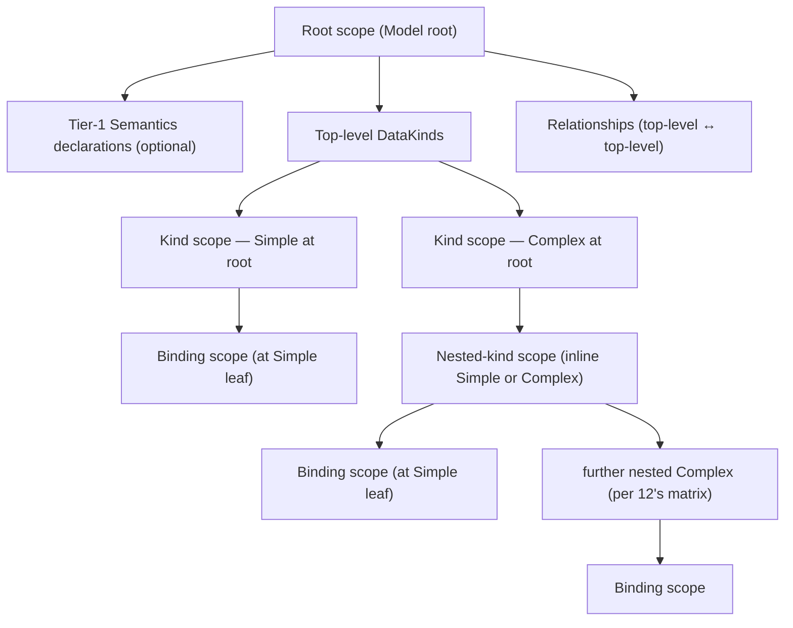

# Scope Chain

This leaf owns the four-level scope tree (Root / Kind / Nested-kind / Binding), tree-shape invariants, the nested-kind structural label concept (non-Semantics naming at nested scope levels), and the downstream interaction boundaries. Related: [semantics identity](semantics-identity.md) for global identity rules and [lookup algorithm](lookup-algorithm.md) for compile-time name resolution.

> **Struct ownership (2026-04-17 consolidation).** Struct shapes for the Semantics catalog (`Dimension`, `Measure`, `Metric`, `AdditivityType`, `SemiAdditive`, `AiContext`, `Keys`) are ratified in [`18 §4`–`§9`](../18_entities.md). This doc owns the *scope chain*, the *identity and lookup rules*, the *planner contract for `Additivity`*, the *`Constraint` evaluation lifecycle*, and the *cross-kind reference invariant*. Where body sections below cite `ColumnMapping`, read `SemanticMapping` per `18 §10`; where they cite `DimensionType::{Categorical,Continuous,...}`, read `DimensionType` per `18 §4.2`. Scope-chain and lookup content is unaffected.
>
> **Status:** ratified across all sections. §8 (Constraint) realizes the generic per-carrier framework with Measure and Metric as v1 carriers; Dimension, Filter, Key, DataKind are reserved carriers for future-design extensions.

## 1. Purpose and Scope

`11` ratifies the naming and scoping rules a `SemanticModel` must satisfy, and the lookup mechanics `compile` applies when producing a `SemanticManifest`. It is the first foundations doc after `10` because every subsequent doc refers to Semantics by name; nothing downstream (`12`–`17`, `20`–`25`, `31`–`37`) is well-defined without a pinned scope model.

**What `11` ratifies:**

- The **scope chain** (§2) — four named levels, strictly tree-shaped.
- The **identity rule** for Semantics names (§3) — global identity, unified namespace.
- The **YAML declaration form** (§4) — single-form rule with scalar shorthand, field-driven role.
- The **shape-vs-resolution-variant** boundary (§5) — which fields lock across all occurrences of a name; which may differ per DataKind.
- The **Semantics element catalog** (§6) — Dimension, Measure, Metric, Filter, Key.
- **`Additivity`** (§7) as a first-class Measure / Metric property, including SemiAdditive axis encoding and the per-variant planner contract.
- **`Constraint`** (§8) authoring location — DSL grammar, evaluation boundary, and derivation semantics are TBD.
- The **cross-kind reference rule** (§9) — Relationship-required invariant + compile / plan split.
- **Nested-kind structural labels** (§10) — non-Semantics naming at nested scope levels.
- The **lookup algorithm** (§11) — how `compile` resolves a named reference.
- The **Precondition catalog** (§12) for name-related checks run by `validate` and `compile`.

**What `11` does NOT specify** (forward-refs):

- Which container types may nest which child types, and in what forms — `12`.
- `DataType` variants and `Grain` axes — `13`.
- `Expr<L>` authoring grammar, function registry, expression-level name resolution mechanics — `14`.
- `Binding`, `SemanticMapping`, `PhysicalSource`, and binding-coverage rules — `15` (struct shape for `SemanticMapping` lives in `18 §10`).
- `Relationship`, `ComposedSemanticInterface`, and cross-kind-walk semantics at plan time — `16`.
- `TemporalShape` and its effect on `Additivity` defaults — `17`.
- Per-DataKind-variant strategies (Grainset rollup choice, Unionset branch assembly, Joinset path walking) and `Constraint` evaluation — `20`–`25`.

**Key invariants from `00` that `11` directly upholds:**

- **I5** — all name resolution is compile-time work, captured in the `SemanticManifest`; nothing resolvable remains for `plan`.
- **I8** — the `SemanticManifest` carries every index `plan` needs; `11`'s lookup algorithm feeds those indices.
- Global identity and unified-namespace rules (§3) refine `00 §4.1` for Semantics.

## 2. The Scope Chain

Four named levels, strictly tree-shaped (no DAG). Every declaration and every reference lives in exactly one scope level.

| Level | Owner | What it holds | Exposed to consumers? |
|---|---|---|---|
| Root scope | Model root | optional Tier-1 Semantics shape declarations; top-level DataKind containers; global `Relationship` block | — (Model root is a container, not queryable) |
| Kind scope | a top-level DataKind | the DataKind's declared `SemanticInterface` (Dimensions / Measures / Metrics / Filters / Keys); local-to-kind resolution variants (per §5) | yes — the DataKind's interface is the consumer-facing contract |
| Nested-kind scope | an inline nested DataKind under a top-level Complex | strategy-specific structural configuration; further nested children; optional non-Semantics structural label | no — nested kinds declare no interface |
| Binding scope | a Simple leaf's `Binding` | `SemanticMapping` to `PhysicalSource`(s) | no — purely physical realization |

**Tree shape — no referenced children.** A Complex DataKind's children are always **inline**; there is no `ref:` form that points to a top-level DataKind as a member of another Complex. Reuse across top-level DataKinds happens through (a) Semantics naming (global identity makes `revenue` in two different DataKinds the same logical thing), (b) `PhysicalSource` reuse at the Binding layer (ratified in `15`), and (c) `Relationship` declarations at Model root (ratified in `16`). No scope-level reuse mechanism exists, by design — it would turn the scope tree into a DAG and complicate every rule that follows.

### 2.1 Diagram — the scope chain

**Notes on the diagram.**

- Tier-1 Semantics declarations under Root scope are *not* DataKinds; they are shape-only contracts reusable by any top-level DataKind (§4).
- Relationships live at Root scope and connect pairs of top-level DataKinds only. They do not traverse into nested-kind scope, and they are not a member of any Complex.
- Nested-kind scope has no interface; its role is structural. Bindings appear only at Simple leaves, regardless of whether the Simple is at Root-level or nested.
- The tree is finite and acyclic by construction of the Model. Nesting depth is bounded by `12`'s nesting matrix.

## 10. Nested-Kind Structural Labels

Nested DataKinds (inline Complex or Simple children of a top-level Complex) do NOT declare Semantics. They may, however, carry a `name:` as a **structural label** for diagnostic reference and strategy-internal naming (e.g. `path.left: sales` referring to a Joinset member labeled `sales`).

### 10.1 Rules for structural labels

- A structural label is scope-local to the enclosing parent Complex.
- It does NOT enter the global Semantics namespace.
- It cannot collide with another structural label in the same parent (sibling labels must be unique).
- It CAN collide with a Semantics name — the two are in different namespaces entirely. A Joinset member labeled `sales` and a Semantics named `sales` do not interact.
- It is NOT accessible to expressions — expressions reference Semantics, never structural labels.

### 10.2 Use cases

- Joinset join-path specification (`path.on.left: <label>`).
- Grainset grain-level naming (`levels: [{ grain: day, name: daily }, …]`).
- Diagnostic messages (pointing a compile error at a labeled subtree).

### 10.3 Blocks accepting a structural `name:`

Ratified here; parse-time block shapes in `12`.

| Block | Structural `name:` role |
|---|---|
| Nested inline `datasets:` entries (Simple under a Complex) | label for the Simple leaf within its parent Complex (used by Joinset `path.on.<side>:` and diagnostics) |
| Nested inline `unionsets:` / `grainsets:` / `joinsets:` entries | label for the nested Complex within its parent (used by diagnostics; not referenced by expressions) |
| Joinset `path:` block's endpoints | `path.on.left:` and `path.on.right:` name sibling structural labels (not Semantics) |
| Grainset `levels:` entries | `- grain: day, name: daily` — label for diagnostic reference and optional strategy hints |
| Model-root `relationships:` entries | `name:` identifies the Relationship for diagnostics and for Joinset `path:` references (16) |

Blocks that do NOT accept a structural `name:` (any `name:` found there is a Semantics name, subject to §3–§5 rules):

- `dimensions:` / `measures:` / `metrics:` / `filters:` — at Model root OR inside a Kind scope. Their `name:` is a Semantics name.
- `keys:` — `name:` is not present; Keys are identified by their `kind:` + `members:` (§6.5).
- `binding:` and `column_mapping:` — Binding-scope blocks; column references follow `15`'s rules.

The full nesting matrix (which Complex may contain which nested-block form) is ratified in `12`.

## 14. Interaction with Downstream Docs

- **12** — refines the nesting matrix (which Complex can contain which child) and the inline-only enforcement for nested children. `11`'s scope chain + tree-shape invariant constrains what `12` may legally permit.
- **13** — defines `DataType` variants and `Grain` axes referenced by shape fields in §5. A Semantics's `data_type` is one of `13`'s variants.
- **14** — defines the `Expr<L>` authoring surface, the `FunctionRegistry`, and expression-level resolution rules (§11.2 points to `14` for function-name resolution).
- **15** — defines `Binding`, `SemanticMapping`, `PhysicalSource`, and the no-empty (binding-required) Precondition details. `11 §12 N-C4` forward-refs to `15` for the concrete check.
- **16** — defines `Relationship`, `ComposedSemanticInterface`, and cross-kind-walk semantics. `11 §9` references `16` for path-selection disambiguation.
- **17** — defines `TemporalShape` and the defaults driving `Additivity` (§7.2).
- **20–25** — per-DataKind-variant strategies; `Constraint` evaluation semantics at plan time.

## Testing Strategy

- Tree-shape no-DAG invariant (no `ref:` form creates cycles or sibling-to-sibling edges)
- Structural-label uniqueness within parent (N-V3)
- Blocks accepting/rejecting structural names (§10.3 catalog)
- Downstream doc boundaries (§14 forward-ref integrity)
- **Shared harness:** [`../../testing/50_behavioral_contract_gates.md`](../../testing/50_behavioral_contract_gates.md).
