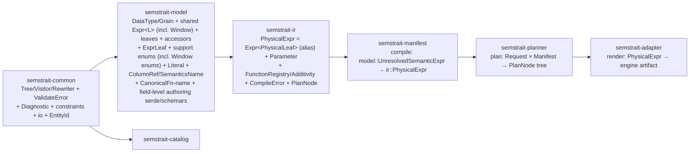

# Crate Placement

This leaf defines crate ownership for the expression layer post-item-Y inversion: `semstrait-common` owns traversal traits, `semstrait-model` owns the shared `Expr<L>` and authoring vocabulary, `semstrait-ir` owns the resolved `PhysicalExpr` alias and `Parameter` leaf, and `semstrait-manifest` owns the compile fold. The item-Y inversion flips the edge from `model→ir` to `ir→model`, keeping the authoring surface public and the resolved IR internal.

## 9. Crate Placement

The layered model maps onto the workspace DAG as follows. Each crate has exactly one job. Placement follows the **public/internal split** ratified as `STATUS.md` item Y (2026-06-15), which **inverts** the earlier item-Q direction: the unresolved *authoring* vocabulary is public and lives in `semstrait-model`; `semstrait-ir` owns only the **resolved** form and depends on model; the shared traversal traits sit in the DAG leaf `semstrait-common`. The governing rule: a type's home follows the expression family that carries it — authored vocabulary is public (model), the resolved IR is internal (ir).

### 9.1 `semstrait-common`

Owns (DAG-leaf shared vocabulary consumed below `semstrait-model`):

- The traversal trait family `Tree`, `Visitor<N>`, `Rewriter<N>` (§3.1) — impl'd by both `model::Expr<L>` and `ir::PlanNode`; the shared leaf is its natural home (item Y / V5). Orphan-safe: each `impl Tree` lives with its local type.
- The narrow expression-side error kind `ValidateError` — co-moves with `Tree` (it is `Tree::with_new_children`'s return type) and is primitive-only (no `DataType`/`CanonicalFn` payload), so it sits cleanly in the leaf (V5).
- The cross-cutting diagnostic primitives `Diagnostic<K>`, `Diagnostics<K>`, `Diagnose`, `Severity`, `Location`, `Span`, `SourceId` per `[30 §5](../../apis/30_api_contracts.md)`.
- The constraint-DSL shapes `MeasureConstraints`, `DimensionConstraints`, `AggregationConstraints` per `[11 §8.3](../11_names_and_scopes.md)` / `§8.4`.
- `EntityId` per `[31 §2.1](../../apis/31_semstrait_common.md)`; the byte-blob `io` transport per `[31b](../../apis/31b_semstrait_common_io.md)`.

Does NOT own:

- The logical-type vocabulary. The **authored** types `DataType` / `Grain` live in `semstrait-model` (§9.2, item Y / V2); the **non-authored** types `TypeClass` (signature matching only), `Schema` / `SchemaColumn` (plan-side output schema, compile/catalog-derived per `[35 §11.1](../../apis/35_semstrait_ir.md)` Q-IR-006) stay in `semstrait-ir` (§9.3). (`semstrait-common` never owned any of them; the pre-Y diagram that showed `DataType`/`Schema` here was stale — item X placed them in ir; item Y homes **only** `DataType`/`Grain` in model, per V2's explicit scope.)
- `ExprLeaf` — it names `DataType` (`inferred_type`), and common must not depend on model, so it lives in model (V5).
- The expression vocabulary, support enums, literal/identifier carriers, `CanonicalFn` — all in `semstrait-model` (§9.3).

Rationale: `semstrait-common` is the workspace-DAG leaf (I7). Only the family-agnostic machinery (traversal traits + their primitive error) and genuinely cross-cutting primitives sit here. Anything that names an authored type (`DataType`) is pulled up into `semstrait-model`.

### 9.2 `semstrait-model` — public authoring surface

Owns the **unresolved authoring vocabulary** (the public contract a side application consumes):

- The **authored** logical-type vocabulary `DataType`, `Grain` (at `data_type:` / `cast:` targets / temporal grains) per `[13](../13_types_and_grain.md)` (item Y / V2). `ir` imports these. (The non-authored `TypeClass` / `Schema` / `SchemaColumn` stay in `semstrait-ir` — §9.3.)
- The shared expression family `Expr<L>` (§3.3) — every structural variant **including `Window`** (author-rejected, not absent — item Y / V3 as amended by A2). Instantiated as `UnresolvedSemanticExpr = Expr<UnresolvedSemanticLeaf>` and `UnresolvedPhysicalExpr = Expr<UnresolvedPhysicalLeaf>`; ir re-uses the same enum as `PhysicalExpr = Expr<ir::PhysicalLeaf>` (§9.3).
- The leaf sets `UnresolvedSemanticLeaf` (§3.5) and `UnresolvedPhysicalLeaf { Column, Literal }` (§3.4) — the author-facing physical leaf carries **no `Parameter`**.
- The `ExprLeaf` trait (§3.2) — names model-owned `DataType` (V5).
- The per-kind accessor enums `DimensionAccessor` / `MeasureAccessor` / `MetricAccessor` / `KeyAccessor` (§4.1).
- The structural-variant support enums `BinaryOpKind`, `UnaryOpKind`, `AggregationOp`, `AggregateKind`, `LikeKind`, `CastFailure`, the **`Window` support enums `WindowFn` / `WindowFrame` / `WindowFrameKind` / `WindowBound`** (item Y / V10 as amended by A2 — they follow the `Window` variant onto the shared `Expr<L>`), and the typed-literal carrier `Literal` (rosters per §3.3; each support type follows the family that carries it).
- The identifier carriers `ColumnRef`, `SemanticsName` (§3.4 / §3.5).
- The canonical function **name identity** `CanonicalFn` (syntactic; validated against a model-local table per `[14a](../14a_function_catalog.md)`). The resolved registry/`Additivity` machinery stays in `semstrait-ir`.
- The YAML authoring surface — bare `Expr<L>` expression fields (§6.1) + parse-site dispatch (§6.2) + the reserved-tag catalog (§6.4); the inline DSL is reserved/deferred (§6.3).
- The author-facing entity types (`Dimension`, `Measure`, `Metric`, `Key`, `Filter`, …) per `[18](../18_entities.md)`; structural validation not requiring catalog resolution.
- **Hand-rolled** field-level authoring serde and `schemars` adapters on every expression field (§6.1 / §6.4; item Y / V7 as refined by A2, mechanism per doc 45) — friendly tags only; letting a bare `Expr<L>` reach the author path through its own derives (deriving `#[serde(tag,content)]` / `JsonSchema` *as the authoring projection*) is forbidden so `binary_op:` / `type:` / `content:` never reach authored YAML or its schema. The shared `Expr<L>`'s own derived `type`/`content` serde is the machine transport form (`ir::PhysicalExpr` alias), a distinct surface reached only by the machine path.

Depends only on `semstrait-common`. Has **no dependency on `semstrait-ir`** (the item-Y inversion).

### 9.3 `semstrait-ir` — internal resolved IR

Owns the **resolved** vocabulary and the machinery the post-compile pipeline operates on:

- `PhysicalExpr` — the resolved canonical tree, defined as the **alias** `Expr<ir::PhysicalLeaf>` (item Y / V3 as amended by A2 — *not* a concrete re-declared enum; the shared `Expr<L>` already carries every variant, `Window` included). Leaf set `PhysicalLeaf { Column, Literal, Parameter }` (§3.4) where `Parameter` is compile-emitted only.
- The `Parameter` placeholder + `ParameterKey` closed enum (§5.1 / §5.2) — the one resolved-only leaf.
- The resolved function machinery: `FunctionRegistry`, `FunctionSpec`, `FnSignature`, `ParamType`, `ReturnTypeRule`, `FunctionCategory`, `RegistryExtension`, and `Additivity` / `DimensionAxis` per `[14a](../14a_function_catalog.md)`. (`CanonicalFn`'s name identity is imported from model.)
- The wider error kind `CompileError` (raised by `ReturnTypeRule::Custom` callbacks; resolution-stage failures). `ValidateError` lives in `semstrait-common` (§9.1).
- `PlanNode` and the canonical plan-tree per `[35](../../apis/35_semstrait_ir.md)`.
- The **non-authored** type vocabulary `TypeClass` (function-signature matching), `Schema`, `SchemaColumn` (plan-side output schema) — retained here, not moved to model: compile/catalog-derived and consumed by manifest/planner/adapter per `[35 §11.1](../../apis/35_semstrait_ir.md)` (Q-IR-006); V2's scope is `DataType`/`Grain` alone. `Schema`/`SchemaColumn` are built from the model-imported `DataType`.

Imports the shared `Expr<L>` + `ExprLeaf` (to instantiate `PhysicalExpr`), `DataType`, `Grain`, `Literal`, the structural discriminators, the **`Window` support enums** (A2), `ColumnRef`/`SemanticsName`, and the `CanonicalFn` name — all from `semstrait-model` (it does **not** import `TypeClass`/`Schema`/`SchemaColumn` — those are ir-owned above). **Does not** own a `SemanticExpr` — the unresolved semantic form lives in model as `UnresolvedSemanticExpr` (§9.4, item Y / V6).

Rationale: ir is the **internal** representation. Inverting the item-Q direction keeps the public authoring surface (model) free of resolution/registry/plan machinery while ir retains exactly the resolved types adapters and the planner consume.

### 9.4 `semstrait-manifest`

Owns the resolution fold:

- The `compile` entry point that folds `model::UnresolvedSemanticExpr` → `ir::PhysicalExpr` per `[19 §3](../19_expression_flow.md)`. This is the relocated lowering: manifest imports **both** model (the unresolved input) and ir (the resolved output), so the fold legally sits here.
- `ResolvedExprTable` and per-`(Semantics, Binding)` storage per `[19 §3.2](../19_expression_flow.md)`.
- The sealed `SemanticManifest` artifact.
- The wider `manifest::CompileError` (resolution-stage errors — `UnknownReference`, `NoRelationshipPath`, `CyclicReference`, `TypeInferenceFailure`, …). Embeds `Ir(ir::CompileError)` via D.ii kind-nesting for function-return-type failures.

Depends on `semstrait-ir` (resolved types, registry, `ir::CompileError`) and `semstrait-model` (the unresolved authoring input). Invents no new expression types.

### 9.5 Downstream

`semstrait-planner` and `semstrait-adapter` consume `PhysicalExpr` and `PlanNode` from `semstrait-ir`. They contribute no new expression types; planner-side `Parameter` substitution and adapter-side engine rewrites operate on `PhysicalExpr`. When the planner constructs an unresolved predicate from a `Request` (the `QueryFilter` lowering), it builds `model::UnresolvedSemanticExpr` — a legal `planner → model` reference.

## 10. Design Invariants Upheld

The following `[00 §9](../../00_overview.md)` invariants find concrete realisations here:

| Invariant | Realisation in `14` |
|---|---|
| **I1** — no raw SQL in canonical layers | `Expr<L>` is a typed tree. The reserved inline-DSL string form (§6.3) is deliberately not canonical — and is parse-rejected for compound strings in v1; a bare authoring string resolves to a typed leaf at compile. No string crosses a stage boundary as SQL. |
| **I2** — physical types belong to adapters | Every leaf and structural variant types in canonical `DataType` per `[13](../13_types_and_grain.md)`. No `arrow::*` / `spark::*` types appear. |
| **I3** — no engine/provider branching in canonical crates | `FunctionCall { name: CanonicalFn, .. }` references canonical identities. Per-engine name remaps and rewrites live in adapters per `[14a](../14a_function_catalog.md)`. |
| **I5** — name resolution at compile time | `UnresolvedSemanticLeaf::Field` / `Dimension` / `Measure` / `Metric` / `Key` carry unresolved names at parse; compile substitutes per binding (§8). `PhysicalLeaf` carries no semantic names. |
| **I7** — strict acyclic crate DAG | The placement in §9 preserves the DAG; `semstrait-common` remains the leaf. Post-item-Y direction: `semstrait-common` ↑ `semstrait-model` ↑ `semstrait-ir` ↑ `semstrait-manifest` ↑ `semstrait-planner` ↑ `semstrait-adapter` (the `model→ir` edge is inverted to `ir→model`). |
| **I10** — non-exhaustive public sum types | Every public enum in §3–§5 is `#[non_exhaustive]`. Adding a `MeasureAccessor` variant, an `Expr<L>` structural variant, or a `ParameterKey` is additive. |
| **I12** — first-class typed diagnostics | Tree-construction invariant violations surface as `Diagnostic<ValidateError>` where the single tree-machinery `ValidateError` lives in `semstrait-common` (§9.1), shared by `model::Expr<L>` and `ir::PlanNode` traversal (item Y / V5). Model's parse-time `Block(Expr<L>)` construction surfaces this common type directly — the prior `ir::ValidateError` intermediary is gone (`model → common` is the only hop). `semstrait-model`'s SR-* validate-**stage** roster is a separate kind (`32 §9.5`) that references the common tree error for that one path. Compile-time resolution failures surface as `Diagnostic<CompileError>` (`semstrait-manifest::CompileError` for the wider resolution stage, embedding `Ir(ir::CompileError)` for function-return-type failures). |

## Testing Strategy

- **Crate DAG preservation:** The workspace DAG `semstrait-common` ↑ `semstrait-model` ↑ `semstrait-ir` ↑ `semstrait-manifest` ↑ `semstrait-planner` ↑ `semstrait-adapter` is acyclic per I7. No `semstrait-model → semstrait-ir` edge; the item-Y inversion holds.
- **Placement enforcement:** `Tree` / `ValidateError` in `semstrait-common`; `Expr<L>` / `DataType` / `Grain` / authoring leaves in `semstrait-model`; `PhysicalExpr` alias + `Parameter` + `FunctionRegistry` in `semstrait-ir`; `compile` fold in `semstrait-manifest`.
- **Each type in exactly one crate:** §9 distribution table is exhaustive. No type is homed in multiple crates.
- **Shared harness:** [`../../testing/50_behavioral_contract_gates.md`](../../testing/50_behavioral_contract_gates.md).
