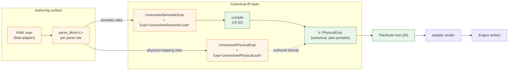

# Layered Expression Model

This leaf establishes the foundational layered model for expressions — one structural tree `Expr<L>` parameterized by leaf type, with semantic sugar as an optional richer leaf set on top of the canonical physical form. The three concerns (universal traversal, canonical IR, authoring sugar) are separated along leaf-set boundaries, avoiding parallel structural enums. See [tree-trait.md](tree-trait.md) for the traversal contract and [expr-structural-variants.md](expr-structural-variants.md) for the structural-variant catalog.

> **Status:** ratified (second refinement landed 2026-05-18; cascade rebases of `19` / `31` / `35` complete per `STATUS.md` item N). This chapter ratifies a **layered expression model** in which one structural tree `Expr<L>` is parameterized over its leaf set, with two authoring leaf sets — `UnresolvedPhysicalLeaf` (author-facing physical leaves) and `UnresolvedSemanticLeaf` (per-kind typed leaves enabled by semantic declarations); the resolved `ir::PhysicalLeaf` extends the physical set.
>
> The shape: `SemanticExpr` is sugar on top of `PhysicalExpr` — they share `Expr<L>`'s structural variants, differ only in leaf set. Per-kind typed semantic leaves (`Field`, `Dimension`, `Measure`, `Metric`, `Key`) carry sugar accessors as `Option<XxxAccessor>` fields (no wrapping `Accessor` enum, no `EntityRef`/`Access` indirection). The authoring surface provides six canonical constructors (`col`, `field`, `dim`, `measure`, `metric`, `key`) with exact YAML-tag ↔ Rust-DSL alignment.

## 1. Purpose and Scope

`semstrait` is canonical-first per `[00 §3](../../00_overview.md)`. Two conversion boundaries exist: YAML → canonical (compile-time) and canonical → engine (adapt-time). Expressions are the unit through which both boundaries operate.

**What `14` ratifies:**

- One structural tree shape `Expr<L>` shared across the pipeline (§3.3).
- Two authoring leaf sets: `UnresolvedPhysicalLeaf` (author-facing physical) and `UnresolvedSemanticLeaf` (per-kind typed); the resolved `ir::PhysicalLeaf` extends the physical set (§3.4 / §3.5).
- The authoring layer aliases `UnresolvedSemanticExpr` / `UnresolvedPhysicalExpr` (model) and the resolved `ir::PhysicalExpr` (§3.6).
- The per-kind typed semantic leaves (`Field`, `Dimension`, `Measure`, `Metric`, `Key`) and the optional sugar accessors carried as `Option<XxxAccessor>` fields on each typed leaf (§4).
- The compile-emitted `Parameter` placeholder mechanism with typed `ParameterKey` (§5.1–§5.3).
- The non-coercion / pass-through posture — no implicit type promotion at the canonical layer (§5.4).
- The six canonical authoring-surface constructors (`col`, `field`, `dim`, `measure`, `metric`, `key`) with exact YAML-tag ↔ Rust-DSL alignment (§6).
- The YAML authoring surface (bare `Expr<L>` fields), parse-site dispatch, and bare-identifier rules (§6).
- Per-site shape gates governing which authoring sites admit which expression shapes (§7).
- The auto-mapping synthesis pre-step at compile and the `Column`-under-manual-mapping rejection rule (§8).
- The crate placement of the expression layer (§9).

**What `14` does NOT ratify** (forward-refs):

- `CanonicalFn` newtype, `FunctionRegistry`, `FunctionSpec`, signature polymorphism, return-type rules, function-level `Additivity`, adapter extension API — `[14a](../14a_function_catalog.md)`.
- The compile-time resolution algorithm and the Phase A / Phase B pipeline (substitution, cross-DataKind BFS, cycle detection, type inference, Semantics-boundary reconciliation, `ResolvedExprTable` shape, per-`(Semantics, Binding)` keying, auto-mapping synthesis, sugar contract, Phase B placement, advisory channel) — `[19](../19_expression_flow.md)`.
- `SemanticMapping` value shape — `[18 §10](../18_entities.md)`.
- `Binding` algorithm — `[15](../15_mapping_and_binding.md)`.

**Key invariants from `[00 §9](../../00_overview.md)` that `14` directly upholds:**

- **I1** — no raw SQL in canonical layers. `Expr<L>` is a typed tree; no `String`-as-SQL fields.
- **I2** — physical types belong to adapters. `Expr<L>` types in canonical `DataType` per `[13](../13_types_and_grain.md)`.
- **I3** — no engine/provider branching in canonical crates. Engine specifics live behind `FunctionRegistry` extensions (`14a`) and adapter rewrites.
- **I5** — name resolution at compile time. The per-kind typed `UnresolvedSemanticLeaf` variants (`Field`, `Dimension`, `Measure`, `Metric`, `Key`) carry unresolved names at parse and are resolved at compile; `PhysicalLeaf` carries no semantic references.
- **I7** — strict acyclic crate DAG. The placement in §9 preserves the workspace DAG.
- **I10** — non-exhaustive public sum types. Every leaf set, structural variant, and accessor enum carries `#[non_exhaustive]`.
- **I12** — first-class typed diagnostics by stage. Construction-time validations and compile-time errors flow through `Diagnostic<K>` per `[00 §9](../../00_overview.md)`.

## 2. Layered Model

### 2.1 Three concerns, one structural tree

The expression layer carries three distinct concerns:

1. **Universal traversal** — children, with-new-children, visitor/rewriter walks. Stage-agnostic.
2. **Canonical IR form** — engine-portable expressions that adapters render. Uses `CanonicalFn` for function identity. References physical columns and compile-emitted parameters.
3. **Authoring sugar** — references to declared semantic entities (Dimensions / Measures / Metrics / Keys per `[18](../18_entities.md)`) and per-entity shorthand operators (e.g. `measure.previous`, `metric.delta`). Available only inside a Semantic context.

The design separates these three concerns along **leaf-set boundaries** (item Y / V3):

- A single shared `Expr<L>` enum (`semstrait-model`) carries every structural operator (`BinaryOp`, `Case`, `FunctionCall`, `Aggregate`, `Window`, …) recursively over its leaf type `L`. `Window` is **author-rejected**, not absent (item Y / V3 as amended by A2): the variant exists so the compile sugar fold can construct it (§4.2), but no parser accepts window syntax.
- `UnresolvedSemanticLeaf` defines the sugar-enabled leaves; `UnresolvedPhysicalLeaf` (`Column` / `Literal`, no `Parameter`) the author-facing physical leaves.
- Two authoring aliases instantiate it (`semstrait-model`): `UnresolvedSemanticExpr = Expr<UnresolvedSemanticLeaf>` and `UnresolvedPhysicalExpr = Expr<UnresolvedPhysicalLeaf>`.
- The resolved `ir::PhysicalExpr` (`semstrait-ir`) is the **same `Expr<L>`** instantiated at `ir::PhysicalLeaf` — i.e. `Expr<ir::PhysicalLeaf>`, an alias, not a re-declared enum. The only thing the resolved instantiation adds is the `Parameter` leaf its leaf set admits. Exact rosters: §3.3–§3.6.

This is the **layered model**: structure is declared once on the shared `Expr<L>` and instantiated three times (two authoring, one resolved); sugar is a richer leaf set, not a parallel structural enum. The one construct genuinely exclusive to the resolved form is the `Parameter` leaf.

### 2.2 Pipeline at a glance

Two boundary crossings:

- **Authoring → canonical**: parse-site dispatch (`semstrait-model`) decides whether the source enters as `UnresolvedSemanticExpr` or `UnresolvedPhysicalExpr`. Semantic sites (Measure `expr:`, Metric `expr:`, computed Dimension `expr:`, DataKind-level Filter `expr:`) parse to `UnresolvedSemanticExpr`. Physical-mapping sites (`semantic_mapping.<x>.expr:`) parse to `UnresolvedPhysicalExpr` directly. Per-site catalog is in §7.
- **Canonical → engine**: adapter rewrites the resolved `ir::PhysicalExpr` to engine-native shapes after the planner finalises the `PlanNode` tree per `[35](../../apis/35_semstrait_ir.md)`.

`UnresolvedSemanticExpr` is a **transient** form. It exists between parse and compile; it is never persisted in the `SemanticManifest`, never observed by the planner, and never observed by adapters. Only the resolved `ir::PhysicalExpr` (modulo `Parameter` leaves bound at plan time per §5) crosses the manifest boundary.

### 2.3 Why "sugar on top of canonical"

The framing matters for clarity:

- The **canonical form is foundational**. The resolved `ir::PhysicalExpr` is what every downstream stage consumes; its authoring counterpart `UnresolvedPhysicalExpr` must be expressible without any reference to semantic declarations (an author writing `semantic_mapping.<x>.expr:` writes `UnresolvedPhysicalExpr` directly with no semantic context).
- **Sugar is opt-in**. `UnresolvedSemanticExpr`'s additional leaves (`Field`, `Dimension`, `Measure`, `Metric`, `Key`) are only meaningful inside a Semantic context — i.e. when at least one Dimension / Measure / Metric is declared. They give authors a shorter, name-driven authoring surface that compiles down to the canonical form.
- **Structural operators are shared**. `BinaryOp`, `Case`, `FunctionCall`, `Aggregate`, `Window`, etc. carry the same shape across every instantiation, and the resolved `ir::PhysicalExpr` is the same `Expr<L>` at `ir::PhysicalLeaf` — it re-declares nothing. The compile pipeline does not re-implement structural traversal; it transforms leaves.

This is what avoids duplicating structural variants across the three instantiations, while keeping the type system honest about which leaves are legal where (`Parameter` is the one resolved-only leaf; `Window` is shared but author-rejected).

## 11. Out of Scope for v1

Deferred per `[00 §10](../../00_overview.md)` and per the workspace's pre-1.0 surface policy:

- **`Window` author surface** — compile-emitted only via Family-B sugar-accessor lowering.
- **Subquery / correlated subquery / lambda / mask forms** — cross-DataKind correlation rides through typed semantic leaves + `Relationship` per `[16](../16_composition.md)`.
- **Substrait wire emission as a canonical target** — Substrait is one adapter output, not canonical-isomorphic.
- **Stringly-typed parameter IDs** (`"$1"`) — superseded by typed `ParameterKey` (§5.2).
- **Type-class-parameterised function signatures** — v1 uses overload-set polymorphism per `[14a](../14a_function_catalog.md)`.
- **Full SQL query parsing** — out of scope; future optional crate may lower `sqlparser-rs` AST at the boundary.

## 12. Cross-References

Upstream:

- `[00_overview.md](../../00_overview.md)` — canonical-first contract, vocabulary, invariants I1–I12.
- `[13_types_and_grain.md](../13_types_and_grain.md)` — canonical `DataType` set; `Grain`.
- `[15_mapping_and_binding.md](../15_mapping_and_binding.md)` — `SemanticMapping`, the `Binding` process consumed at compile.
- `[16_composition.md](../16_composition.md)` — `Relationship` graph; cross-DataKind reference resolution path.
- `[18_entities.md](../18_entities.md)` — entity-kind canonical names (Dimension / Measure / Metric / Key); `Measure` / `Metric` `(agg:, expr:)` pairing; model-level `Additivity`; `SemanticMapping` value shape.

Refinement:

- `[14a_function_catalog.md](../14a_function_catalog.md)` — `CanonicalFn`, `FunctionRegistry`, signature polymorphism, return-type rules, function-level `Additivity`.
- `[19_expression_flow.md](../19_expression_flow.md)` — Phase A / Phase B compile pipeline; resolution algorithm; sugar contract; per-site shape gates; Phase B placement; advisory channel.

Downstream:

- `[../apis/31_semstrait_common.md](../../apis/31_semstrait_common.md)` — traversal traits `Tree`/`Visitor`/`Rewriter` + `ValidateError` (no expression vocabulary).
- `[../apis/32_semstrait_model.md](../../apis/32_semstrait_model.md)` — `semstrait-model` authoring surface: `Expr<L>` families, leaves, accessors, support enums, `Literal`, `DataType`/`Grain`, `CanonicalFn`-name, field-level authoring serde + parse-site dispatch.
- `[../apis/33_semstrait_manifest.md](../../apis/33_semstrait_manifest.md)` — compile fold (`model::UnresolvedSemanticExpr` → `ir::PhysicalExpr`); `ResolvedExprTable` storage; `Provenance`.
- `[../apis/35_semstrait_ir.md](../../apis/35_semstrait_ir.md)` — resolved-IR crate (resolved alias `PhysicalExpr = Expr<ir::PhysicalLeaf>`, the `Parameter` leaf, `FunctionRegistry`, `PlanNode`; Window support enums imported from model).
- `[../apis/36_semstrait_adapter.md](../../apis/36_semstrait_adapter.md)` — adapter rendering of `PhysicalExpr` to engine artifacts.

## Testing Strategy

- **Structural gates:** Doc 14 seam uniqueness — the shared `Expr<L>` is declared exactly once in `semstrait-model`; no parallel enum exists in `semstrait-ir`.
- **Instantiation coverage:** Three aliases legally instantiate the shared `Expr<L>`: `model::UnresolvedSemanticExpr`, `model::UnresolvedPhysicalExpr`, `ir::PhysicalExpr`.
- **Transience enforcement:** `UnresolvedSemanticExpr` never crosses the manifest boundary — the `SemanticManifest` stores only `ir::PhysicalExpr`.
- **Compile postcondition:** Every `UnresolvedSemanticExpr` input to `compile` yields `ir::PhysicalExpr` output with no `Field` / `Dimension` / `Measure` / `Metric` / `Key` leaves.
- **Shared harness:** [`../../testing/50_behavioral_contract_gates.md`](../../testing/50_behavioral_contract_gates.md).
