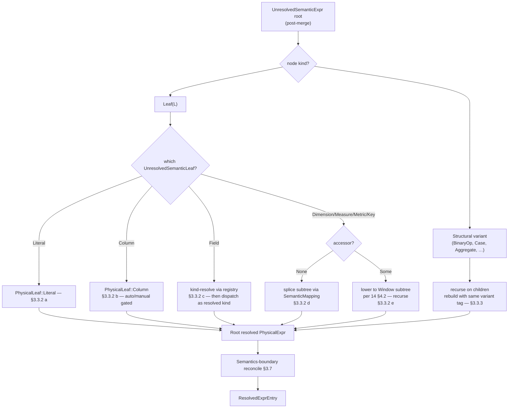
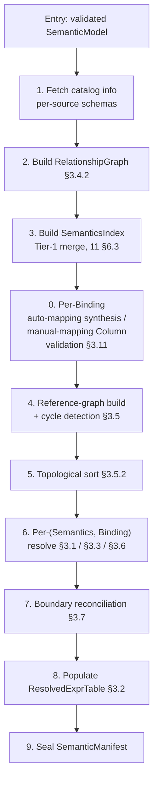

# Phase A Resolution

This leaf defines the Phase A compile-time resolution algorithm that transforms `model::UnresolvedSemanticExpr` into `ir::PhysicalExpr`. It covers the resolve entry point, ResolvedExprTable structure, per-leaf substitution rules, cross-DataKind path resolution, cycle detection via Tarjan SCC, bottom-up type inference, semantics-boundary reconciliation, per-Binding keying, and sub-pass ordering. See [two-phase-pipeline.md](two-phase-pipeline.md) for the phase boundary contract and [phase-b-placement.md](phase-b-placement.md) for plan-time placement.

## 3. Phase A — Compile-Time Resolution

Phase A is the compile-time, synchronous, `Request`-free pass that turns every author-declared `UnresolvedSemanticExpr` into a fully substituted, type-annotated `PhysicalExpr` stored in the `SemanticManifest`'s `ResolvedExprTable`. It finalizes every forward reference from `[14](../14_expressions.md)` that points at "compile-time resolution", "the `ResolvedExprTable`", "substitution algorithm", "cross-DataKind path resolution", "cycle detection", or "semantics-boundary reconciliation" (cf. `14 §3.7`, `§4.2`, `§5.3`, `§7.5`, `§8`).

Per `[00 §5](../../00_overview.md)`, this work lives inside `compile`. Per `[00 §9](../../00_overview.md)`'s **I5** and **I6** invariants, the entire substitution and lookup work completes **before** any plan is built, so that `plan` (and every stage downstream) can consume a single `ResolvedExprTable::lookup(name, binding_id)` in O(log n) per reference. Phase A is the algorithm that says exactly **what that lookup returns** and **how the compile stage populated it**.

The Phase A pass is built on the layered expression model ratified in `[14 §3](../14_expressions.md)`:

- The structural skeleton (`Expr<L>` per `14 §3.3`) is shared between the authoring `model::UnresolvedSemanticExpr = Expr<UnresolvedSemanticLeaf>` and the resolved `ir::PhysicalExpr` (`14 §3.6` / `§9`).
- The semantic leaf set carries **per-kind typed leaves** (`Literal`, `Column`, `Field`, `Dimension`, `Measure`, `Metric`, `Key`) per `14 §3.5`, with per-kind accessor enums (`DimensionAccessor`, `MeasureAccessor`, `MetricAccessor`, `KeyAccessor`) sitting as `Option<…>` fields on the typed leaves per `14 §4.1`.
- The physical leaf set carries `Column`, `Literal`, and the compile-emitted `Parameter` placeholder per `14 §3.4`.

The transformation is therefore a leaf-rewrite, not a structural rewrite: every structural variant of `Expr<L>` (`BinaryOp`, `Case`, `FunctionCall`, `Aggregate`, `Window`, …) passes through with its children recursively transformed, while each `UnresolvedSemanticLeaf` variant carries its own per-kind rule (§3.3). Sugar accessors carried on typed leaves lower to canonical `Window`-rooted subtrees per `14 §4.2`. The output `PhysicalExpr` is fully resolved modulo `Parameter` placeholders that Phase B binds against the `Request`.

### 3.1 Top-level contract: the `resolve` entry point and substep order

Phase A is one entry point with internal substeps. It is a manifest-side free
function per §2.1's "Crate placement": its input type (`model::UnresolvedSemanticExpr`)
is model-owned, but `LoweringCtx`, the index types, and `CompileError` are
manifest-layer, so the fold cannot live on an `impl` in either `semstrait-model`
or `semstrait-ir` under I7.

```rust
/// Compile-time lowering from `model::UnresolvedSemanticExpr` to `ir::PhysicalExpr`.
///
/// Synchronous, pure, Request-free. Runs once per `(Semantics, Binding)` pair
/// during `compile`. Returns `PhysicalExpr` modulo `Parameter` placeholders
/// bound at Phase B (§2.1).
pub(crate) fn resolve(
    expr: model::UnresolvedSemanticExpr,
    ctx:  &LoweringCtx<'_>,
) -> Result<ResolvedExprEntry, CompileError>;
```

`LoweringCtx` carries the read-only inputs the substeps need plus the bookkeeping a single `resolve` call mutates:

```rust
pub(crate) struct LoweringCtx<'a> {
    pub registry:           &'static FunctionRegistry, // ir-owned (14a); compile-stage fn resolution
    pub relationship_graph: &'a RelationshipGraph,
    pub scope_chain:        &'a ScopeChain,
    pub all_semantics:      &'a SemanticsIndex,
    pub all_bindings:       &'a BindingIndex,
    pub schemas:            &'a SchemaIndex,
    pub semantic_mapping:   &'a SemanticMapping,        // for the current binding
    pub recursion:          &'a mut RecursionState,
}
```

All fields are read-only at the input-model sense except `recursion`, which carries the DFS visited-set used by §3.5's cycle detection. The function is **pure**: no I/O, no time dependence, no RNG; the only mutation is bookkeeping for cycle detection, scoped to a single `resolve` invocation tree.

**Precondition.** The incoming `UnresolvedSemanticExpr` already carries an `Aggregate` root if a Measure or Metric authored it via the `(agg:, expr:)` dual-field surface — that wrapping happens at parse time per `[32 §5.4](../../apis/32_semstrait_model.md)`.

The substep order is load-bearing:


**Why this order.**

- Sugar elimination **before** substitution — a typed leaf with `accessor: Some(_)` lowers to a `Window` whose `args` still reference the original entity; substitution must see the lowered shape, not the sugared leaf.
- Sugar elimination **to fixpoint** — `Delta` / `PercentChange` lower into compositions containing more accessor-bearing typed leaves; iteration converges.
- Substitution **before** fold — metadata-static branches the fold collapses (per-Binding source markers in a `Case`) only become visible after `SemanticMapping` substitutes the gating typed leaves.
- Reconciliation **last** — the root's `inferred_type` is only stable after substitution and folding settle.

Compile orchestrates `resolve` per `(Semantics, Binding)` pair during the per-binding resolution sub-pass (§3.9 step 6). Authors and adapters never call it directly.

### 3.2 The `ResolvedExprTable`

#### 3.2.1 Shape

```rust
pub struct ResolvedExprTable {
    entries: BTreeMap<ResolvedExprKey, ResolvedExprEntry>,
}

pub struct ResolvedExprKey {
    pub semantics_name: SemanticsName,
    pub binding_id:     EntityId,
}

pub struct ResolvedExprEntry {
    pub physical_expr:      PhysicalExpr,
    pub layer:             ExprLayer,    // applicability layer (§3.2.6); persisted on the manifest expr (33 §7.2)
    pub inferred_type:      DataType,
    pub referenced_columns: Vec<String>,
    pub path_signature:     Option<PathSignature>,
    pub provenance:         Provenance, // shape owned by 33; see §3.2.5
}
```

**Why `BTreeMap`.** Deterministic iteration order for `SemanticManifest` serialization and downstream artifacts (adapter column-projection lists); O(log n) lookup is acceptable because the plan-time hot path is dominated by expression-tree traversal, and typical manifests carry `n` in the low thousands.

**The binding key is an `EntityId`** (the binding's durable id per `15 §2.2` — a deterministic UUIDv5 generated at compile, `33 §9.1`). It is globally unique and stable across Model edits that don't change the binding. Author-facing diagnostics still quote `DataKind.name / Binding.name`; `BindingName` is not the key (unique only within its owning `Dataset`, not globally). The retired u32 binding-id handle (the pre-`EntityId` key) is no longer used.

**`SemanticsName`** is the canonical identity newtype from `[11 §4](../11_names_and_scopes.md)` — one unified global namespace. The **kind** of a Semantics (Dimension / Measure / Metric / Key) is encoded in the variant tag of the authored `UnresolvedSemanticLeaf` and reconciled against the registry during substitution (§3.3).

#### 3.2.2 Determinism

`BTreeMap<ResolvedExprKey, _>` orders lexicographically by `(semantics_name, binding_id)` (the latter an `EntityId`). Given frozen inputs, substitution is a pure post-order walk; BFS in §3.4 explores neighbors in deterministic **relationship-name order**; multiple shortest paths surface as `AmbiguousRelationshipPath` (no tie-break). Identical inputs → byte-identical `ResolvedExprTable` (compile-layer evidence for `00 §9` **I4**).

#### 3.2.3 Lookup contract

```rust
impl ResolvedExprTable {
    pub fn lookup(&self, name: &SemanticsName, binding_id: EntityId) -> Option<&ResolvedExprEntry>;
    pub fn lookup_all(&self, name: &SemanticsName) -> impl Iterator<Item = (EntityId, &ResolvedExprEntry)>;
    pub fn iter(&self) -> impl Iterator<Item = (&ResolvedExprKey, &ResolvedExprEntry)>;
}
```

`lookup` is O(log n); `lookup_all` ranges `BTreeMap` over a single `SemanticsName` (used by `ComplexDataKind` source selection over multiple Bindings). Sealed manifests are `Arc`-wrapped and immutable — no `insert`/`remove`/`update` on the public API.

#### 3.2.4 Serialization posture and the compile-time / persisted split

`ResolvedExprTable` is the **compile-time working set**; its persisted form is owned by `[33](../../apis/33_semstrait_manifest.md)`. The two are not identical, and the split follows what is content-derived vs binding-context-dependent:

- **`physical_expr` + `layer` are interned into the content-deduped pool** `ManifestExpressions.physical: BTreeMap<PhysicalExprId, ManifestExpression { expr, layer }>` (`33 §7.2`). The `layer` is a pure function of the tree (§3.2.6), so it rides on the deduped entry. (This supersedes any earlier "stored inline, no interning pool" wording.)
- **The per-`(SemanticsName, binding EntityId)` context fields** — `inferred_type`, `referenced_columns`, `path_signature` — are **not** functions of the expression tree alone (a shared tree bound to different sources may infer different types / traverse different paths), so they do **not** belong on the deduped pool entry. They are persisted on the manifest's per-binding expression reference: `SemanticBinding.resolved: BTreeMap<EntityId, ResolvedExprMeta>` (`33 §7.1`), keyed by the same semantic `EntityId` as the binding's `mapping`. `19` ratifies the field set (this `ResolvedExprEntry`); `33` ratifies the persistence container (`ResolvedExprMeta` + the `resolved` map). The seal-time decomposition of `ResolvedExprEntry` — `{physical_expr, layer}` to the pool, `{inferred_type, referenced_columns, path_signature}` to `resolved`, `provenance` to manifest metadata — is documented at `33 §7.1`.

Shape-level contract: `entries` encodes in `BTreeMap`'s natural iteration order.

#### 3.2.5 `Provenance`

Per-entry diagnostic-reporter carrier (which source `Location`s contributed which occurrences during Tier-1 / Tier-2 merge per `[11 §6.3](../11_names_and_scopes.md)`). Never leaves the manifest, never read at plan time or adapt time. **Shape owned by `[33 §<ResolvedExprEntry>](../../apis/33_semstrait_manifest.md)`** (it is a manifest-storage concern, not a Phase-A algorithm concern); `19` only requires that `compile` populates it.

#### 3.2.6 Layer classification

After substeps 0–4 produce the `PhysicalExpr`, Phase A classifies its `ExprLayer` (`[14 §3.8](../14_expressions.md)`; type at `[35 §5.5](../../apis/35_semstrait_ir.md)`) as a **pure function of the resolved tree** — `classify(tree)`:

```text
classify(t):
  if no Aggregate node occurs anywhere in t          -> Scalar
  else if the root node of t is an Aggregate          -> Aggregate
  else                                                -> PostAggregate   # Aggregate(s) strictly below a non-Aggregate root
```

- **`Window` is not a layer of its own.** A `Window` whose argument subtree contains an `Aggregate` (an *aggregation-relative window* — e.g. a `measure.previous` accessor lowered over the aggregated grain) makes the tree fall into `PostAggregate` by the rule above (the root is the `Window`, an `Aggregate` is below it). A `Window` over raw columns only (e.g. `dimension.lag`, no `Aggregate` descendant) classifies as `Scalar`. No separate `Windowed` layer exists in v1 (reserved, `35 §5.5`).
- Classification runs on the **Phase A** tree (before Phase B's aggregate-lift, `§7`); the lift does not change the classification, it consumes it.

The layer is independent of the authoring `SemanticRole`: a Dimension whose `expr` resolves to a subtree containing an `Aggregate` is `PostAggregate`. It is recorded on `ResolvedExprEntry.layer` and persisted with the physical expression (`33 §7.2`); CX1 re-validates `layer == classify(expr)` at load. This is the single piece of "extra data" that lets Phase B (`§6`) place each expression onto the correct `PlanNode` layer (pushdown vs aggregate vs post-aggregate) without re-walking semantic provenance.

### 3.3 The substitution algorithm — per-leaf-kind rules

#### 3.3.1 Overview

For every `(SemanticsName, EntityId)` pair the Model exposes, compile calls the `resolve` fold against the Semantics's merged `expr:` tree (the post-Tier-1-merge `UnresolvedSemanticExpr` per `[11 §6.3](../11_names_and_scopes.md)`). The implementation is a **post-order walk** over the `Expr<UnresolvedSemanticLeaf>` tree:

1. For each `Expr<L>::Leaf(leaf)` node, dispatch to the per-leaf-kind rule (§3.3.2). The rule returns either a `PhysicalLeaf` (wrapped in `Expr::Leaf`) or a structural subtree (e.g. an accessor-sugared typed leaf lowers to a `Window`-rooted subtree, which then recurses).
2. For each structural variant of `Expr<L>` (`BinaryOp`, `Case`, `FunctionCall`, `Aggregate`, `Cast`, `InList`, `Between`, `Like`, `IsNull`, `Coalesce`, `NullIf`, `Window`, `UnaryOp`), recurse on the children, then rebuild the same variant with the resolved children. The structural shape passes through unchanged (§3.3.3).
3. At the root, run Semantics-boundary reconciliation (§3.7) — possibly wrapping the root in a `Cast`.
4. Emit a `ResolvedExprEntry` with the resolved expression, root `inferred_type`, flat `referenced_columns`, optional `path_signature`, and `provenance`.



#### 3.3.2 Per-leaf-kind rules

##### a. `UnresolvedSemanticLeaf::Literal(lit)`

Trivial:

- Output: `Expr::Leaf(PhysicalLeaf::Literal(lit))`.
- `inferred_type`: per `14 §3.5` / `[13 §2.1–2.4](../13_types_and_grain.md)` — the literal's canonical type. `{literal: {type: T, value: v}}` specifies `T` explicitly; bare forms (`{literal: 42}`, etc.) follow `14 §5.2` defaults (`Integer` / `Double` / `String` / `Boolean`; bare `Null` → `DataType::Unknown` at the node, reconciled at root).
- `referenced_columns`: empty.
- `path_signature_contrib`: empty.

**Untyped `Null` handling.** A bare `Null` literal at a node whose type cannot be fixed by context flows as `DataType::Unknown` and either unifies with siblings (in `Case` / `Coalesce` / `BinaryOp` comparisons) or propagates to the root, where §3.7's reconciliation either pins it via the Semantics's declared `data_type:` or raises `CompileError::TypeInferenceFailure`.

##### b. `UnresolvedSemanticLeaf::Column(name)` — conditionally legal

Per `14 §3.5`, `UnresolvedSemanticLeaf::Column` is **type-admissible** (the parser can construct it) but **context-validated** at compile. Its legality depends on the owning binding's `semantic_mapping` mode:

- **Under `semantic_mapping: auto`** — legal. Step 0 of compile (§3.11) has already synthesized a `SemanticMapping` entry for `name`. The leaf rewrites to `Expr::Leaf(PhysicalLeaf::Column(ColumnRef(name)))`, with `inferred_type` looked up in `binding.source.schema()[name].data_type` mapped to canonical `DataType` via `[13 §2](../13_types_and_grain.md)`.
- **Under manual `semantic_mapping`** — rejected. Per §3.11, step 0 has already raised `CompileError::ColumnInSemanticExprUnderManualMapping { binding, location }` and resolution never reaches this leaf. If it does (compile bug, test fixture), an `unreachable!` assertion fires.

If the physical column does not exist in the binding's `PhysicalSource` schema under `auto`: `CompileError::UnresolvedColumn { name, binding }`.

- `referenced_columns`: one-element vector `[name]`.
- `path_signature_contrib`: empty.

##### c. `UnresolvedSemanticLeaf::Field(name)` — kind-resolved untyped fallback

Per `14 §3.5`, `Field` is the untyped semantic reference whose kind is resolved at compile by registry lookup. The dispatcher:

1. Looks up `name` in `ctx.all_semantics` to determine its declared kind (`Dimension` / `Measure` / `Metric` / `Key`).
2. If `name` does not resolve in any visible scope per `[11 §11.1](../11_names_and_scopes.md)`, raises `CompileError::UnknownReference { name, scope: Scope::of(site) }`.
3. If `name` resolves to a kind, **re-dispatch** the leaf as if the author had written the corresponding typed leaf (`Dimension { name, accessor: None }`, `Measure { name, accessor: None }`, etc.). The substitution then proceeds per §3.3.2.d.
4. Under `semantic_mapping: auto`, name lookup may resolve to a physical column rather than a declared semantic. In that case the leaf re-dispatches as `Column(name)` per §3.3.2.b. The §3.11 step 0 has already synthesized the appropriate `SemanticMapping` entry.

The `Field` variant therefore does not survive into `PhysicalExpr` by construction — it is always either a `Column` (under auto, when the name maps to a physical column) or a substituted typed-semantic subtree.

##### d. `UnresolvedSemanticLeaf::Dimension { name, accessor: None }` (and `Measure / Metric / Key` analogous)

The core compile-time substitution site for kind-pinned typed leaves. Steps:

1. **Resolve `name`** via the binding's `SemanticMapping` per `[15](../15_mapping_and_binding.md)` and the visible scope chain per `[11 §11.1](../11_names_and_scopes.md)`. The lookup yields the registered Semantics for `name`.
2. **Kind-check.** If the registered Semantics's declared kind differs from the leaf's variant tag (e.g. `Dimension { name: "x" }` but `x` is registered as a Measure), raise `CompileError::SemanticKindMismatch { authored_kind, registered_kind, name, location }`. The leaf was authored with a specific kind contract (`dim("x")` vs `measure("x")` etc.); a registry disagreement is an author error.
3. **Same-DataKind vs cross-DataKind.** If the target Semantics's owning DataKind is the same as the current Binding's owning DataKind, recurse into the target's merged `expr:` using the current Binding. Splice the resolved `PhysicalExpr` subtree in-place. No `path_signature_contrib`. If different, trigger cross-DataKind path resolution per §3.4. The target's `expr:` is resolved against one of its own Bindings (picked per §3.4.4). The resolved subtree is spliced in, and the path is appended to `path_signature_contrib`.
4. **Cycle bookkeeping.** Mark `name` as visited in the DFS recursion state (§3.5) for the duration of the recursive call; unmark after return. Cycles surface as `CompileError::CyclicReference` before any expression rewriting happens.
5. **`inferred_type`** of the substituted subtree is the root `inferred_type` of the target's resolved entry (per §3.6's bottom-up rule; the topological order from §3.5 ensures the target is already resolved).
6. **`referenced_columns`** contribute the target's columns, prefixed by join-key columns required to traverse each hop in any cross-DataKind path (§3.10).

The typed-semantic leaves are **not** present in the output `PhysicalExpr` per `14 §3.7`: `PhysicalLeaf` has no `Field` / `Dimension` / `Measure` / `Metric` / `Key` variants. The substitution algorithm therefore cannot leave one behind — it rewrites the leaf into the target's resolved expression.

##### e. `UnresolvedSemanticLeaf::{Dimension | Measure | Metric | Key} { name, accessor: Some(acc) }` — sugar elimination

A typed leaf carrying `accessor: Some(acc)` is sugar that lowers at compile to a canonical `Expr::Window`-rooted subtree per `14 §4.2`:

```text
UnresolvedSemanticLeaf::Measure { name: "revenue", accessor: Some(MeasureAccessor::Previous) }
  ─→ Expr::Window {
       function:     <derived from accessor — e.g. Lag(1) for Previous>,
       args:         [Expr::Leaf(UnresolvedSemanticLeaf::Measure { name: "revenue", accessor: None })],
       partition_by: [Expr::Leaf(PhysicalLeaf::Parameter(Parameter {
                       key:       ParameterKey::RequestDimensionsMinusTemporal,
                       data_type: DataType::Unknown, // late-bound by Phase B
                     }))],
       order_by:     [Expr::Leaf(PhysicalLeaf::Parameter(Parameter {
                       key:       ParameterKey::RequestTemporalAxis,
                       data_type: DataType::Unknown,
                     }))],
       frame:        Some(<derived from accessor>),
     }
```

After lowering, the inner `Expr::Leaf(UnresolvedSemanticLeaf::Measure { accessor: None })` recurses through §3.3.2.d.

**Fixpoint behaviour.** Some accessors (`Delta`, `PercentChange` on `MeasureAccessor` / `MetricAccessor`) lower to compositions that still contain typed leaves with `accessor: Some(_)`. For example, `Measure { accessor: Some(Delta) }` lowers to `op - op.Previous`, where `op.Previous` is itself a typed leaf with `Some(Previous)`. The Phase A sugar-elimination substep runs to fixpoint so every typed leaf with a non-`None` accessor is eliminated before the substitution substep begins.

The per-kind accessor enums (`DimensionAccessor`, `MeasureAccessor`, `MetricAccessor`, `KeyAccessor`) define a closed set of lowerings; the per-kind mapping table lives in `14 §4` and is not re-ratified here.

#### 3.3.3 Structural variants — recurse and rebuild

For every non-`Leaf` variant of `Expr<L>` (per `14 §3.3`), the algorithm recurses on the children, then rebuilds the same variant tag with resolved children. Variant tag and non-child fields are preserved verbatim (this is the `Tree::with_new_children` contract from `[31 §3.2](../../apis/31_semstrait_common.md)`).

**Three structural notes:**

- **`Aggregate` passes through.** `Expr::Aggregate { op, args, distinct, filter }` is a structural variant on both the authoring `Expr<UnresolvedSemanticLeaf>` and the resolved `PhysicalExpr` per `14 §3.3`; the typed-leaf model leaves it intact. Aggregate-specific metadata (grain, additivity) stays on the Semantics per `[18 §5.2](../18_entities.md)`, never inside the expression node.
- **`Window` is compile-emitted only.** Author-facing parsers reject window syntax (`14 §6.4.1`); `Window` nodes enter exclusively via sugar elimination (§3.3.2.e). The algorithm constructs them, never receives them from authors, then recurses into their child slots.
- **`FunctionCall` triggers registry lookup at compile.** Function-name **existence**, **signature match**, and **return-type inference** are compile-stage validation in this fold, against the `semstrait-ir`-owned `FunctionRegistry` (consumed read-only via `ctx.registry`). Per `[14a §3](../14a_function_catalog.md)`: unknown name → `UnknownFunction`; bad arity → `FunctionArityMismatch`; no matching signature → `NoMatchingSignature`; return type computed by `ReturnTypeRule`. The parser does **not** consult the registry — it only validates the `model::CanonicalFn` *name* syntactically against a model-local table (`14 §9.2` / `STATUS.md` item Y / V4); the registry is the compile-time source of truth.

#### 3.3.4 Scope and identifier resolution at the walk

Phase A does not re-derive name-resolution rules — it consumes `[11 §11.1](../11_names_and_scopes.md)`'s lookup algorithm verbatim. At every leaf that carries an identifier (`Field`, `Dimension`, `Measure`, `Metric`, `Key`, or — under auto-mapping — `Column`):

- Build a scope chain for the current resolution site (Root, owning DataKind, nested-kind if any, current Binding).
- Walk the chain from innermost outward: `Binding → Nested-kind (if applicable) → Kind → Root` (global Semantics registry).
- Success: identifier resolves to a Semantics slot (typed leaves dispatch to §3.3.2.c–e), to a Binding column (auto-mapping `Column` per §3.3.2.b), or to nothing (`UnknownReference`).
- Failure: `CompileError::UnknownReference { name, scope }` where `scope` is the innermost scope where the walk started.

#### 3.3.5 Per-leaf-kind summary table

| `UnresolvedSemanticLeaf` variant | Output | `inferred_type` | Recurses into | Notes |
|---|---|---|---|---|
| `Literal(lit)` | `Expr::Leaf(PhysicalLeaf::Literal(lit))` | literal's canonical type | — | bare `Null` flows as `DataType::Unknown` until reconciliation |
| `Column(name)` (auto mapping) | `Expr::Leaf(PhysicalLeaf::Column(ColumnRef(name)))` | schema lookup | — | conditionally legal — see §3.11 |
| `Column(name)` (manual mapping) | rejected | — | — | `ColumnInSemanticExprUnderManualMapping` (§3.11) |
| `Field(name)` | re-dispatch as resolved kind | resolved kind's `inferred_type` | target's `UnresolvedSemanticExpr` (or `Column` under auto) | registry kind-resolve, then per §3.3.2.d |
| `Dimension { name, accessor: None }` | splice resolved subtree | target's root `inferred_type` | target's `UnresolvedSemanticExpr` | `SemanticKindMismatch` if registry kind differs |
| `Measure { name, accessor: None }` | splice resolved subtree | target's root `inferred_type` | target's `UnresolvedSemanticExpr` | as above |
| `Metric { name, accessor: None }` | splice resolved subtree | target's root `inferred_type` | target's `UnresolvedSemanticExpr` | as above |
| `Key { name, accessor: None }` | splice resolved subtree | target's root `inferred_type` | target's `UnresolvedSemanticExpr` | as above |
| `{Dimension|Measure|Metric|Key} { name, accessor: Some(acc) }` | lower to `Expr::Window`-rooted subtree | `Window`'s `inferred_type` | recursively (fixpoint) | per `14 §4.2` |
| structural variant (`BinaryOp`, `Case`, `Aggregate`, `Window`, `FunctionCall`, `Cast`, …) | same variant tag, resolved children | per §3.6 | each child | shape shared between the authoring `Expr<UnresolvedSemanticLeaf>` and `PhysicalExpr` per `14 §3.3` |

### 3.4 Cross-DataKind path resolution

#### 3.4.1 The contract

When a typed semantic leaf (`Dimension` / `Measure` / `Metric` / `Key` with `accessor: None`, or a `Field` that resolves to one of those kinds) targets a Semantics whose owning DataKind differs from the current Binding's owning DataKind, Phase A's substitution substep triggers **cross-DataKind path resolution**: a BFS over the `Relationship` graph from the current Binding's DataKind to the target's DataKind.

The path is recorded in the entry's `PathSignature` for plan-time join-subgraph materialization (`[16 §4](../16_composition.md)`).

#### 3.4.2 The `RelationshipGraph`

Built once at `compile` time after `validate` (so endpoints are known-valid):

```rust
pub struct RelationshipGraph {
    kinds:         BTreeMap<DataKindName, DataKindNode>,
    relationships: BTreeMap<EntityId, Relationship>,
    by_kind:       BTreeMap<DataKindName, Vec<EntityId>>, // relationship EntityIds, name-ordered
}
```

A relationship is referenced by its `EntityId` (`18 §2.1`) — durable and stable across edits. The `by_kind` adjacency vectors are ordered by relationship **name** so neighbor iteration (and thus path enumeration) is deterministic and author-meaningful.

#### 3.4.3 The BFS algorithm

Shortest-path BFS over the `RelationshipGraph` from `from_kind` to `to_kind`. Returns the path's `Vec<EntityId>` on a unique hit. The walk records the shortest depth `d` on first reach, then exhausts every path of depth `d`; deeper paths are ignored.

- 0 hits → `CompileError::NoRelationshipPath { from, to }`.
- 1 hit  → success.
- ≥ 2 hits at depth `d` → `CompileError::AmbiguousRelationshipPath { from, to, paths }` (hard error; no tie-break).

**Why shortest-path + hard ambiguity, not tie-break.** A tie-break (declaration order, lex order) would silently pick one path when the Model expressed two equally-valid intentions; that violates `00 §9` **I4** (determinism) and surprises authors. Ambiguity is an authoring defect that demands explicit relationship-graph disambiguation. Neighbor iteration uses relationship-name order to keep the `paths` vector content stable across compiles (and stable across edits, since it no longer rides a compile-counter). Termination follows from the visited-depth map and the bounded `|kinds|` frontier.

#### 3.4.4 Binding selection for the spliced subtree

The target Semantics is resolved against **every** available Binding on the target DataKind, producing one `ResolvedExprEntry` per target binding (stored separately under `(target_name, target_binding_id)`). When the current expression substitutes a typed semantic leaf, it splices in the target's `PhysicalExpr` from one specific target binding selected by the enclosing Binding's composition context (§3.8).

#### 3.4.5 `PathSignature`

```rust
pub struct PathSignature {
    pub paths: BTreeSet<RelationshipPath>,
}

pub struct RelationshipPath(pub Vec<EntityId>); // chain of relationship EntityIds
```

`paths` is a `BTreeSet` so identical relationship chains contributed by multiple leaf sites dedupe deterministically. `path_signature` is `None` when no cross-kind walk occurred (every typed semantic leaf resolved within the current DataKind; no plan-time join needed); `Some(ps)` carries one or more distinct paths whose union the planner materializes as the join subgraph per `[16 §4](../16_composition.md)`. Phase A only populates the structure.

When a single expression contains multiple typed leaves with different paths (e.g. one to `customer` via `order`, another directly to `order`), all paths are recorded; whether the planner intersects paths sharing intermediate relationships or keeps them distinct is the planner's join-subgraph canonicalization concern per `[16 §4.2](../16_composition.md)`.

### 3.5 Cycle detection

#### 3.5.1 The reference DAG

Built after `validate` (structural preconditions) and after Tier-1 / Tier-2 occurrence merge (`[11 §6.3](../11_names_and_scopes.md)`), but **before** `resolve` is called for any Semantics. Compile walks every Semantics's merged `UnresolvedSemanticExpr` tree and collects every typed semantic leaf reference and every `Field` reference (at any depth in the tree). For `Field` leaves whose kind resolves to a column (under auto-mapping), the leaf is a terminal — no outbound edge in the reference graph. For all other typed leaves, the edge points to the referenced Semantics.

This yields a directed graph:

- **Nodes**: `SemanticsName` (global — per `[11 §4](../11_names_and_scopes.md)`).
- **Edges**: `A → B` if `A`'s `expr:` contains any typed semantic leaf (or kind-resolved `Field`) targeting `B`, anywhere in the tree.

Sugar accessors do not change the graph: a typed leaf with `accessor: Some(_)` still references the same name, just with a wrapped lowering. The cycle detector treats sugar and non-sugar references uniformly.

#### 3.5.2 Algorithm — Tarjan SCC

Tarjan SCC over the reference graph; on success returns a topological sort (Semantics in dependency order); on first SCC of size > 1 (or self-loop) returns `CompileError::CyclicReference { cycle }` with members in lexicographic order.

**Why Tarjan + topological sort.** Single pass detects every cycle; the topological order is a free side-product reused by §3.6's bottom-up type-inference pass (no fixpoint needed); stable order is easy to pin down per `00 §9` **I4**.

**Single-cycle reporting.** Phase A reports the first cycle (lexicographically smallest SCC name) per `00 §9` **I12** fail-fast posture; batch-diagnostic mode is a future extension.

#### 3.5.3 Cross-kind cycles + self-loops

Cycles span the global Semantics namespace — not restricted to one DataKind. A Measure on `orders` referencing one on `customers` that references back is detected by the same pass. A trivial self-loop (`measure a` whose `expr` references `measure a`) yields `a → a` in the graph; detected as the SCC `{a}` with a self-loop.

### 3.6 Type inference

#### 3.6.1 Ordering

Strictly bottom-up over the reference DAG: process Semantics in §3.5.2's topological order; for each, walk its `UnresolvedSemanticExpr` post-order; typed-leaf children look up the already-resolved target's `inferred_type`; reconcile the root with any declared `data_type:` per §3.7. No fixpoint — cycles are rejected upstream.

#### 3.6.2 Per-variant rules

- **Leaves.** `Literal` → literal's canonical type per `[13 §2.1–2.4](../13_types_and_grain.md)` (bare `Null` → `DataType::Unknown`, reconciled at boundary). `Column` (under auto) → schema lookup; missing → `UnresolvedColumn`. `Field` → §3.3.2.c kind-resolve then re-dispatch. `{Dim|Measure|Metric|Key} { accessor: None }` → target's root `inferred_type` (already populated by topological order). `{…} { accessor: Some(_) }` → eliminated to `Window` before type inference reaches it.
- **`FunctionCall`** → `ReturnTypeRule` per `[14a §3.4](../14a_function_catalog.md)`. **`Aggregate`** → registry-driven return type for the canonical five (`Sum`/`Avg`/`Count`/`Min`/`Max`) per `[14a §4.7](../14a_function_catalog.md)` + SQL:2016 promotion. **`Window`** → window function's return type per `14a`.
- **`BinaryOp`** → arithmetic: `SameAs(0)` (left operand's type, per `14 §5.4` pass-through); comparison: `Boolean` regardless of operand types; logical (`And`/`Or`): both operands `Boolean`, returns `Boolean` else `TypeInferenceFailure`.
- **`UnaryOp`** → `Negate` preserves operand type; `Not` requires + returns `Boolean`.
- **`Cast { target, … }`** → `target`. No compile-time compatibility check; adapter may reject at render.
- **`Case` / `Coalesce`** → unified type across branches; each `Case.when` must be `Boolean`.
- **`NullIf`** → left operand's type.
- **`InList` / `Between` / `Like` / `IsNull`** → `Boolean`.

#### 3.6.3 Unification

Minimal: two types unify iff (a) identical (including `Decimal` precision/scale) or (b) one is `DataType::Unknown` (untyped `Null`) and the other is concrete (unifies to the concrete). Otherwise `CompileError::TypeInferenceFailure { node, reason }`. **No implicit promotion at unification** — `Integer` and `Long` do not auto-unify; authors write explicit `Cast`. This matches `14 §5.4`'s non-coercion posture and keeps inference deterministic.

#### 3.6.4 The annotation contract

Every leaf carries `ExprLeaf::inferred_type() -> Option<&DataType>` per `[14 §3.2](../14_expressions.md)`; structural nodes derive type from children per §3.6.2. The entry-level `inferred_type: DataType` duplicates the root for O(1) plan-time access without tree traversal.

### 3.7 Semantics-boundary reconciliation

When a Semantics declares `data_type: T` explicitly and the resolved root's `inferred_type` differs, compile wraps the root in `Expr::Cast { target: T, on_failure: Error }` before storing. The author's declared type is authoritative at the boundary.

- **Widening** (`Integer → Long`, `Integer → Double`, `Decimal(10,2) → Decimal(18,2)`, …, per `[13 §2.6](../13_types_and_grain.md)`) — silent.
- **Narrowing** (`Long → Integer`, `Double → Integer`, …) — emits `CompileError::NarrowingCast { inferred, declared }` at `Severity::Warning`; compile succeeds.
- **Orthogonal** (`String → Integer`, …) — treated as narrowing for diagnostic purposes; adapter may reject at render time.

**Interaction with shape inference.** `[11 §6.3](../11_names_and_scopes.md)` runs upstream and pins a single `data_type:` across multi-DataKind Semantics occurrences (or raises `ShapeInferenceConflict`). Phase A reads the pinned value.

**Untyped `Null` at boundary.** `inferred_type: DataType::Unknown` with no declared `data_type:` → `CompileError::TypeInferenceFailure`. With a declared `data_type: T` → wrap `Null` in `Cast(T)`, no diagnostic.

**Author-written outer `Cast`.** When `expr:` already roots in `Cast(T_outer)` and declares `data_type: T_decl`: same `T` → no extra cast; different `T` → emit an additional outer `Cast(T_decl)` and apply the narrowing-diagnostic rule against it.

### 3.8 Per-Binding keying

The `ResolvedExprTable` carries one entry per `(SemanticsName, EntityId)` pair the Model exposes:

| DataKind shape | # entries per Semantics name | Notes |
|---|---|---|
| `Dataset` | 1 | single Binding per Dataset (`[11 §2](../11_names_and_scopes.md)`, `[15](../15_mapping_and_binding.md)`) |
| `Unionset` over N members | 1 per constituent Binding exposing the Semantics | source-selection rule per `[23 §3](../../data-kinds/23_unionset.md)` |
| `Grainset` over N members | 1 per constituent Binding at its grain | cross-grain references trigger §3.4 BFS; path signature records the chain |
| `Joinset` over N members | 1 per constituent Binding exposing the Semantics | plan-time join graph from `path_signature` + the Joinset's declared chain (`[24](../../data-kinds/24_joinset.md)`) |
| Nested kind inside outer kind | 1 per nested-kind Binding + 1 per outer-kind Binding re-exposing it (`[12](../12_nesting_policy.md)`) | scope-chain resolution per §3.3.4 |

Total bound: `Σ (# bindings per DataKind) × (# Semantics exposed per binding)` — typically 10³–10⁴ entries for realistic Models.

### 3.9 Ordering of sub-passes inside `compile`



- **Step 1 is the only I/O step** inside `compile`. Steps 0 and 2–9 are pure in-memory transformations forming a contiguous sync block (`compile` is `async` only because of step 1, per `[10 §3.3](../10_resolution_pipeline.md)`).
- **Step 0 runs between `SemanticsIndex` build and reference-graph build** so the cycle detector sees the post-auto-mapping state. Mechanics: §3.11.
- **`validate` preconditions** (unique DataKind names, valid Relationship endpoints, valid `PhysicalSource`, valid `expr:`/column binding per `[10 §3.2](../10_resolution_pipeline.md)`) are presumed; structural leakage past `validate` is `unreachable!`.
- **Sealed registry** (`[14a §2.1](../14a_function_catalog.md)`) consulted read-only in step 6.
- **Shape inference** from `[11 §6.3](../11_names_and_scopes.md)` runs in step 3 and pins the `data_type:` value step 7 reconciles against.
- **No re-entry.** Topological sort from step 5 guarantees each `(SemanticsName, EntityId)` is resolved exactly once.

### 3.10 Referenced-column harvesting

Each `ResolvedExprEntry.referenced_columns: Vec<String>` is the flat, de-duplicated list of physical columns the resolved `PhysicalExpr` reads. Consumers: binding validation (missing column → `UnresolvedColumn`), plan-time column projection, adapter `SELECT` rendering, predicate / projection pushdown.

**Collection during post-order walk.**

- `Column(name)` (auto) and `Field(name)` resolving to a column (auto) contribute `[name]`.
- `{Dim|Measure|Metric|Key} { accessor: None }` same-DataKind → contributes target's `referenced_columns` (already computed via topological order). Cross-kind → also contributes the join-key columns on both endpoints of every Relationship hop traversed.
- `{…} { accessor: Some(_) }` → after sugar elimination, only the lowered subtree's typed-leaf children contribute (`Parameter` leaves contribute nothing — bound at plan time).
- Structural variants recurse and union.

Output is de-duplicated (via a `BTreeSet<String>` intermediate) but unsorted — the planner sorts as needed. Column names are **binding-native** (no source / schema qualification); qualification is supplied by the binding's `PhysicalSource` at adapt time. Distinct `EntityId`s keep `Unionset`-style name collisions naturally segregated.

### 3.11 Auto-mapping synthesis pre-step

A per-Binding pre-step that handles the conditional legality of `UnresolvedSemanticLeaf::Column` per the binding's `semantic_mapping` mode. **The only place** in Phase A where auto-vs-manual is consulted; after step 0, the rest of the substeps see a uniform normalized state.

**Under `semantic_mapping: auto`** — walk every `UnresolvedSemanticExpr` resolved against this Binding:

- For each `Column(name)` not already in the mapping, synthesize `name → Column(name)` (structurally identical to an authored `<name>: <name>` entry).
- For each `Field(name)` that doesn't resolve to a declared semantic but does match a `PhysicalSource` schema column, same synthesis (this is the "bare-identifier resolves to physical column under auto" case from `[14 §6.5](../14_expressions.md)`).
- If `name` resolves to neither a declared semantic nor a physical column → `CompileError::UnknownReference { name, scope: Binding(b) }`.

After synthesis the binding's `SemanticMapping` is indistinguishable from an explicit one; downstream substeps (`15` binding resolution, adapter column projection, …) reuse the same code path for both modes.

**Under manual `semantic_mapping`** (any explicit `semantic_mapping:` block, even empty) — reject every `UnresolvedSemanticLeaf::Column(name)` in the walked `UnresolvedSemanticExpr` with `CompileError::ColumnInSemanticExprUnderManualMapping { binding, location }`. Manual mapping requires every physical reference to flow through the explicit mapping; inline `col(…)` would bypass that discipline. Remediation: rewrite the leaf as `field(…)`/`measure(…)`/`dim(…)`, add an explicit `SemanticMapping` entry, or switch to `auto`.

**Companion rule — `SemanticKindMismatch`** (fired during §3.3.2.d's kind-check step). A typed semantic leaf with an explicit kind contract (e.g. `measure("x")`) that disagrees with the registry's kind for `name` (e.g. `x` is a Dimension) → `CompileError::SemanticKindMismatch { authored_kind, registered_kind, name, location }`. `Field` leaves never trigger this — they carry no kind contract.

**Idempotent.** Re-running the pre-step on an already-normalized binding is a no-op (synthesis skips covered columns; rejection already terminated). Simplifies test fixtures and `--explain` re-tracing.

### 3.12 Relationship join-key and filter lowering

A `Relationship`'s join keys (`JoinKeyExprPair.from` / `.to`) and residual `filter` are `UnresolvedSemanticExpr` sites (`14 §7`), so they lower through the same Phase A `resolve` pipeline as any other expression — they are **not** a parallel, un-lowered carrier. Each side resolves against its own endpoint's interface (`from`-side keys against the `from` DataKind, `to`-side keys against the `to` DataKind).

The manifest representation (`33 §8A`) is **semantic-id-first**, so lowering decomposes each join-key side rather than inlining a physical expression:

- **Bare-name key** (the common case, e.g. `customer_id`) — resolves to an existing declared semantic (`Dimension` / `Field` / `Key`) on that interface. The manifest `ResolvedJoinKey` side is that semantic's `EntityId`; its physical column is reached through the bound `SemanticMapping` (`15`).
- **Computed key** (e.g. `lower(email)`) — decomposes via the auto-mapping mechanism of §3.11: compile synthesises an implicit `Field` semantic for the expression, binds its lowered `PhysicalExpr` through the binding mapping (`SemanticMappingValue::Expr`, `33 §7.1`), and the `ResolvedJoinKey` side references that synthesised `Field`'s `EntityId`.
- **Residual `filter`** — a whole-rowset Boolean predicate (not a per-side semantic). It lowers to a single `PhysicalExpr` interned in `ManifestExpressions.physical` and is referenced as a `PhysicalExprId` directly on `ResolvedRelationship.filter` (`33 §8A.1`), ANDed into the join condition.

This keeps the join contract expressed at the semantic layer (separation of concerns) while the lowered `PhysicalExpr` lives in the one expression pool — uniform with every other lowered expression, and never re-resolved at plan time (I5 / I8). The `Relationship` graph itself is still consumed for cross-DataKind *path* resolution per §3.4 (a distinct concern from lowering the join predicate).

---

## Testing Strategy

- Cycle detection via Tarjan SCC: construct test cases with self-loops, cross-kind cycles, and acyclic reference graphs; verify `CyclicReference` error emission.
- Type inference bottom-up: verify inferred types propagate correctly through structural variants (`If`, `BinaryOp`, `FunctionCall`); verify unification rules; verify annotation contract.
- Semantics-boundary reconciliation: verify `Cast` emission when declared `data_type` differs from inferred type; verify `NarrowingCast` warning per §8.3.
- EXPR_E_0201-0208 error codes: verify `UnknownReference`, `NoRelationshipPath`, `UnresolvedColumn`, `AmbiguousRelationshipPath`, `TypeInferenceFailure`, `ColumnInSemanticExprUnderManualMapping`, `SemanticKindMismatch` are emitted for corresponding malformed inputs.
- Referenced-column harvesting: verify the algorithm correctly extracts all `Column` leaves from resolved expressions.
- Per-Binding keying correctness: verify one table per `Dataset`, one table per constituent binding in `Unionset` / `Grainset` / `Joinset`.
- **Shared harness:** [`../../testing/50_behavioral_contract_gates.md`](../../testing/50_behavioral_contract_gates.md).
