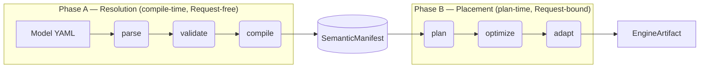

# Two-Phase Pipeline

> **Status:** ratified. Vocabulary throughout is the typed-leaf model from `[14](../14_expressions.md)`.
>
> **Code samples are illustrative.** Exact field names, method signatures, and enum-vs-struct shape may be refined during implementation. The spec asserts the architectural design (two-phase boundary, conversion direction, substep ordering, placement contracts), not the precise Rust spelling.

This leaf defines the two-phase expression pipeline architecture (Phase A — compile-time resolution; Phase B — plan-time placement) and the phase boundary contract between `model::UnresolvedSemanticExpr`, `ir::PhysicalExpr`, and `ir::PlanNode`. For Phase A resolution mechanics see [phase-a-resolution.md](phase-a-resolution.md); for Phase B placement see [phase-b-placement.md](phase-b-placement.md).

## 1. Purpose and Scope

`19` ratifies the **end-to-end compile pipeline for expressions** in semstrait — from the authored, unresolved `model::UnresolvedSemanticExpr` through compile-time resolution into the canonical resolved `ir::PhysicalExpr`, into the planner's `Strategy` for placement into a `PlanNode` tree, up to the canonical engine-portable form an adapter consumes. `14` ratifies the bare type architecture (`Expr<L>`, leaf sets, type aliases, sugar accessors) and its post-item-Y crate placement (`14 §9`); `14a` ratifies function identity; this chapter layers the pipeline mechanics on top.

> **Shorthand (this chapter).** The unresolved authoring form is `model::UnresolvedSemanticExpr` (= `model::Expr<UnresolvedSemanticLeaf>`, `14 §3.6`); the resolved canonical form is `ir::PhysicalExpr`. For readability the prose below writes **`UnresolvedSemanticExpr`** and **`PhysicalExpr`** for the two — the fully-qualified names are authoritative, the short forms are this chapter's local shorthand only. There is **no** `ir::SemanticExpr`: under `STATUS.md` item Y / V6 the semantic form lives in `semstrait-model`, and `semstrait-ir` keeps only the resolved `PhysicalExpr` (`14 §9.3`).

**What `19` ratifies:**

- The two-phase pipeline (§2): Phase A compile-time, `Request`-free, produces `PhysicalExpr` modulo `Parameter`; Phase B plan-time, `Request`-bound, produces a `PlanNode` tree.
- The Phase A algorithm (§3): `resolve` substep order, `ResolvedExprTable` shape, per-leaf substitution, cross-DataKind path resolution, cycle detection, type inference, Semantics-boundary reconciliation, per-Binding keying, sub-pass ordering inside `compile`, referenced-column harvesting, auto-mapping synthesis.
- The sugar contract (§4): Family A constant folding; Family B accessor lowering to `Window`-rooted subtrees.
- Per-site shape gates (§5).
- The Phase B placement contract (§6): filter placement, `group_by` handoff, computed-Dimension placement, Metric semantics, function-tag axis `Additivity`, advisory channel.
- Aggregation handling at the Phase A/B boundary (§7).
- The error model (§8).

**What `19` does NOT ratify** (forward-refs):

- The bare `Expr<L>` AST, `UnresolvedSemanticLeaf` / `PhysicalLeaf` shapes, the `Expr<L>` authoring YAML grammar (field-level friendly projection, `14 §6`) — `[14](../14_expressions.md)`.
- Canonical function identity, `FunctionRegistry`, `FnSignature` polymorphism — `[14a](../14a_function_catalog.md)`.
- `SemanticMapping` shape and the binding algorithm — `[15](../15_mapping_and_binding.md)` + `[18 §10](../18_entities.md)`.
- The `Relationship` shape itself (this chapter consumes it for path resolution) — `[18 §2](../18_entities.md)`.
- Cross-DataKind advisory specialisation roots (e.g. Unionset's `MissingMetadataDisjointnessProof`) — owning chapter (`[23](../../data-kinds/23_unionset.md)`).
- The `Strategy` algorithm bodies that consume `PhysicalExpr` for actual plan construction — `[34](../../apis/34_semstrait_planner.md)`.
- Engine-specific function and operator rewrites — `[36](../../apis/36_semstrait_adapter.md)`, `registry/functions_mapping.md`.
- The on-disk serialization format of the `SemanticManifest` — `[33](../../apis/33_semstrait_manifest.md)`.

**Key invariants from `00 §9` that `19` directly upholds:**

- **I1 / I2 / I3** — canonical layers carry no raw SQL, physical types, or engine branching; `PhysicalExpr` is engine-neutral; `FunctionCall` references `CanonicalFn` identities.
- **I4** — deterministic `SemanticManifest`. `ResolvedExprTable` uses an ordered map keyed by `(SemanticsName, EntityId)`; substitution is pure; path ambiguity resolves by hard error rather than tie-break (§3.4.3).
- **I5** — name resolution at compile time only. Every typed semantic leaf is substituted away at compile time; `PhysicalExpr` values stored in `ResolvedExprTable` carry no `Field` / `Dimension` / `Measure` / `Metric` / `Key` by `14 §3.7`'s structural invariant; plan-time lookups are O(log n) map accesses.
- **I6** — sync hot path. Phase A resolution is a pure, sync transformation over already-loaded inputs; `plan → optimize → adapt` is synchronous and free of hidden I/O.
- **I8** — planner-complete `SemanticManifest`. After `compile` seals, every `(name, binding_id)` combination the planner might demand is already in the `ResolvedExprTable`.
- **I10** — non-exhaustive public sum types.
- **I12** — first-class typed diagnostics by stage; numeric codes serve as spec-cross-reference indices, never as canonical runtime data.

---

## 2. Two-Phase Pipeline

Slices the canonical pipeline (`[00 §5](../../00_overview.md)`) into the two expression-relevant phases. Phase A spans `parse → validate → compile`; Phase B spans `plan → optimize → adapt`. The `SemanticManifest` carries `PhysicalExpr` (modulo `Parameter`) across the phase boundary.



Phase A is **compile-time, synchronous, `Request`-free**: the `resolve` fold runs inside `compile`, consumes authored `UnresolvedSemanticExpr`, and emits `PhysicalExpr` carrying `Parameter(...)` leaves wherever a value must defer to the `Request`. The resulting `PhysicalExpr` is persisted in the `SemanticManifest`'s `ResolvedExprTable` per-`(Semantics, Binding)` pair.

Phase B is **plan-time, `Request`-bound**: `Strategy` (`[34](../../apis/34_semstrait_planner.md)`) runs inside `plan`, binds `Parameter` leaves against the `Request`, lifts `Aggregate` nodes into `PlanNode::Aggregate`, and places the residual `PhysicalExpr` into the plan tree.

The `plan → optimize → adapt` hot path is synchronous and free of hidden I/O per `[00 §5](../../00_overview.md)`.

### 2.1 Phase boundary contract

A single Phase A entry point folds `UnresolvedSemanticExpr` to `PhysicalExpr`:

```rust
// Realized as a manifest-side free function (see "Crate placement" below).
fn resolve(
    expr: model::UnresolvedSemanticExpr,
    ctx:  &LoweringCtx<'_>,
) -> Result<ResolvedExprEntry, CompileError>; // CompileError = manifest::CompileError
```

The output `PhysicalExpr` is fully resolved **modulo `Parameter` placeholders** (`14 §5`); Phase B substitutes those against the `Request`. Detailed substep mechanics live in §3.

**Crate placement (I7).** The fold is owned by **`semstrait-manifest`** (the `compile` module) per `[14 §9.4](../14_expressions.md)`: its INPUT is `model::UnresolvedSemanticExpr` and its OUTPUT is `ir::PhysicalExpr`, so it legally sits at the one layer that imports both `semstrait-model` and `semstrait-ir`. It is a **free function**, not an inherent method on the expression type. The signature's inputs (`LoweringCtx`, the manifest-local `RelationshipGraph` / index types, §3.2) and its error type (`semstrait_manifest::CompileError`, the wide resolution roster of §8.1) all live at the manifest layer; neither `semstrait-model` nor `semstrait-ir` can name them without an upward dependency (`00 §9` I7). An inherent `impl … { fn resolve }` would be forced by Rust's coherence rule into the crate that owns the receiver type — either `semstrait-model` (the input) or `semstrait-ir` (the output), both of which sit *below* manifest — which is exactly the edge I7 forbids. Any `impl`-style rendering below is presentational; the binding contract is "one entry point, run once per `(Semantics, Binding)` pair, owned by `compile`."

Phase B does two things Phase A does not:

- **`Aggregate` lift.** `Aggregate` nodes in `PhysicalExpr` are extracted into `PlanNode::Aggregate` slots; the residual `PhysicalExpr` substitutes column refs to the lifted slots (§7).
- **`Parameter` binding.** Compile-emitted `Parameter` leaves are substituted with concrete values from the `Request` per `[14 §5.3](../14_expressions.md)`. A `Parameter` reaching the adapter is a hard error per `[34 §<Strategy>](../../apis/34_semstrait_planner.md)` postcondition.

---

## Testing Strategy

- Phase boundary invariants (I5, I6): verify that `PhysicalExpr` stored in `ResolvedExprTable` contains no typed semantic leaves (`Field` / `Dimension` / `Measure` / `Metric` / `Key`); verify `resolve` is synchronous (no `async`); verify `plan → optimize → adapt` is free of hidden I/O.
- Request-free / Request-bound split: verify `Parameter` placeholders are present in Phase A output; verify Phase B binds them against the `Request`.
- Crate placement per I7: verify `resolve` is a free function in `semstrait-manifest`, not an inherent method on `model::UnresolvedSemanticExpr` or `ir::PhysicalExpr`.
- **Shared harness:** [`../../testing/50_behavioral_contract_gates.md`](../../testing/50_behavioral_contract_gates.md).
